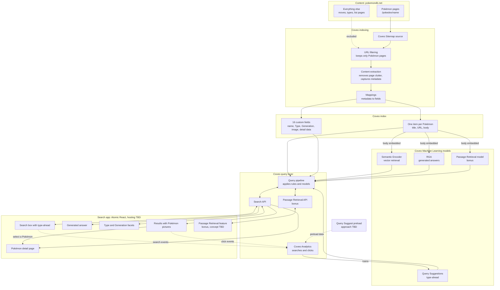

# Architecture

## Solution flow

This diagram shows the components of the solution and how they connect. Choices that are still open are marked "TBD".

## Decisions

### Search interface: Atomic React

We will start with Coveo Atomic through its React wrapper. Atomic provides maintained components for search, facets, type-ahead and generated answers, which keeps the amount of custom interface code small.

The main cost is less control over appearance, because styling is limited to theming and the style hooks each component exposes. We considered building on Coveo Headless with our own components. That offers complete control but takes longer and adds more custom code to maintain. We can revisit this decision if Atomic proves too limiting.

**Coveo documentation:** [Atomic](https://docs.coveo.com/en/atomic/latest/), [Atomic React wrapper](https://docs.coveo.com/en/atomic/latest/usage/frameworks/atomic-react-wrapper) and [Headless](https://docs.coveo.com/en/headless/latest/). Atomic is built on Headless, and the comparison of effort between them is our own judgment.

### Technology stack

| Layer | Choice |
|---|---|
| Language | TypeScript |
| Application | React and Vite |
| Search interface | `@coveo/atomic-react` |
| Custom interface | shadcn/ui and Tailwind |
| Unit and component tests | Vitest and React Testing Library |
| Browser tests | Playwright |
| Evals and data scripts | TypeScript run with Node |
| Coveo indexing extension | Python, tested with pytest |
| CI/CD | GitHub Actions |
| Coveo configuration export | Coveo CLI |
| Hosting | To be decided |

We use TypeScript for the application, tests and scripts. The one exception is the indexing extension, because Coveo runs extensions as Python. We considered Python for evals, mainly for its LLM evaluation libraries. We do not need those libraries because answers are checked against expected facts and citations. Eval speed depends on Coveo's API response times, so the language does not affect performance.

### Eval reference data

Reference data comes from pokemondb.net, the same site we index. A different source could disagree on types, forms or generations and produce false failures.

Because the reference data and the index share a source, the same extraction mistake could affect both. We reduce that risk by verifying difficult cases by hand. Raw HTML stays out of the repository, and only small derived reference data is committed.

### Content scope

The index contains every individual Pokémon page on pokemondb.net, including the newest Pokémon whose pages are still incomplete. Moves, types, list pages such as `all`, `national` and `shiny`, and all other site content are excluded. New Pokémon may have little body text and only a few entries under their Generation.

### Coveo source: Sitemap

We index with a Coveo Sitemap source because we already know exactly which pages we want and the site publishes a list of them. A Sitemap source visits only URLs listed in the sitemap and does not follow links. A Web source starts from one or more URLs and discovers pages by following links.

The sitemap covers the whole site and lists 12,923 URLs. URL rules narrow these to 1,028 individual Pokémon pages: the 1,025 numbered Pokémon and 3 new Generation 10 Pokémon that do not have numbers yet. Coveo applies the same rules to the sitemap URL, so the rules must explicitly include it.

**Benefits**

- **Less complexity:** there is no link traversal to reason about, so the result does not depend on how the site links its pages.
- **No starting-page problem:** a Web source's starting URLs must pass its own filters. A list page used as a starting point would therefore be indexed, unless we supplied all 1,028 Pokémon URLs as starting URLs.
- **Verifiable outcome:** the expected item count is known, so a full crawl can be checked against it.

**Performance**

The performance gain is limited to crawling. Avoiding link traversal means the crawler does not need to visit pages only to discover links. Both source types are bound by the same crawl delay on the pages we index: 2 seconds between requests, as the site's `robots.txt` asks, or about 35 minutes for a full crawl. This estimate assumes Coveo requests only pages that pass the URL rules. The source type has no effect on search latency, which depends on the index and query pipeline.

**Alternatives considered**

- **Web source:** this is the better option when pages must be discovered or when one page must be split into sub-items. We need neither.
- **Push source:** this gives the most control over body text, but we would have to build and maintain our own scraper.

**Coveo documentation**

- [Add a Sitemap source](https://docs.coveo.com/en/1967/): a Sitemap source crawls only listed pages, URL rules also apply to sitemap URLs, and the default delay between requests is 1,000 ms.
- [Add a Web source](https://docs.coveo.com/en/malf0160/): starting URLs are subject to the source's filters.
- [Sitemap source web scraping](https://docs.coveo.com/en/mahe0350/): Sitemap sources do not support sub-items.

The conclusions about complexity, the small crawl performance gain and the absence of any effect on search latency are our own reasoning. The Coveo documentation does not compare the two source types on these points.

### Test source configuration

The source `pokemondb-test-charizard` indexes one page so that configuration can be tested without a full crawl. Charizard is used because its Mega forms have different Types and expose extraction mistakes.

| Setting | Value | Reason | Basis |
|---|---|---|---|
| Sitemap URLs | `https://pokemondb.net/static/sitemaps/pokemondb.xml` | This field expects the sitemap file itself. A normal web page can be read as an HTML sitemap, causing its links to be crawled. | [Add a Sitemap source](https://docs.coveo.com/en/1967/) |
| Exclusion rule | Regex excluding every URL except the sitemap and Charizard | URL rules apply to sitemap URLs as well as pages, so the sitemap must stay allowed. | [Add a Sitemap source](https://docs.coveo.com/en/1967/). Using a single exclusion regex is our own approach because the console offered only exclusion rules. |
| Include all non-excluded pages | On | Provides the inclusion rule every URL must match, leaving the exclusion regex to narrow the result. | [Add a Sitemap source](https://docs.coveo.com/en/1967/) |
| Time between requests | 2,000 ms | The site's [robots.txt](https://pokemondb.net/robots.txt) asks for a 2-second delay. Coveo's default of 1,000 ms is faster than that. | Coveo default: [Add a Sitemap source](https://docs.coveo.com/en/1967/). The choice to follow robots.txt is ours. |
| Execute JavaScript on pages | Off | Coveo advises enabling this only for content rendered by JavaScript, and it can slow crawling. We confirmed that the Type and Generation markup is in the page's HTML. | [Add a Sitemap source](https://docs.coveo.com/en/1967/) and inspection of the Charizard page |
| Web scraping | [`web-scraping.json`](../configs/coveo/web-scraping.json) | Removes page navigation and sections from Moves onward, and extracts 16 metadata values from the page's first form tab. | [Web scraping configuration](https://docs.coveo.com/en/mc1f3573/) and [RGA content requirements](https://docs.coveo.com/en/nb6a0008/). Which sections to remove is our own choice. |
| `performFieldMappingUsingAllOrigins` | True | Maps scraped metadata to fields with the same name. See Field mapping below. | [Add a Web source](https://docs.coveo.com/en/malf0160/), verified on our Sitemap test source |
| Content visibility | Everyone | The content is public and the application has no user sign-in. | Our own decision |

### Use of Coveo APIs

When a platform task would repeat the same manual step, we use a Coveo API instead of the console. This is faster, avoids entry errors and leaves a request body that can be reviewed in the repository.

| Task | API operation | Why | Request body |
|---|---|---|---|
| Create 12 detail-page fields | Field API, [create a batch of fields](https://docs.coveo.com/en/144/), run through Coveo's interactive API explorer while signed in | The detail page needs more data than the search page, and the same options applied to 12 fields would have been slow and error-prone to enter by hand | [`fields-batch-create.json`](../configs/coveo/fields-batch-create.json) |

The first four fields (`pokemon_name`, `pokemon_type`, `pokemon_generation` and `pokemon_image`) were created in the console.

### Body text clean-up

A Pokémon page contains valuable information in layouts that do not survive being flattened into text. A type effectiveness grid becomes a row of numbers such as `½ 2 2 ¼` with no attacking types, and a stat row becomes `78 266 360` with no labels. Generated answers read only the body text, in chunks of about 250 words, so this information would be lost or misleading.

Removing the content would have made the body cleaner but incomplete, so a pre-conversion indexing pipeline extension, [`reconstruct_body.py`](../configs/coveo/extensions/reconstruct_body.py), rewrites it before Coveo creates the body:

| Original content | Result in the body |
|---|---|
| Type effectiveness grid | Sentences such as "Charizard takes 4x damage from Rock." Each form is named, and ability-specific grids name the ability. |
| Stat table | "Charizard base stats: HP: base 78, ranging from 266 to 360 at level 100." with the total |
| Local Pokédex numbers | Kept for the base form only, because they repeat for every form |
| Stat range explanation and "Additional artwork" labels | Removed, because they add no information once the stats are labelled |

Web scraping continues to remove site navigation and everything from the Moves section onward, and to extract the 16 field values.

**Alternatives considered**

- **Remove the content with web scraping:** simplest, but generated answers could not answer questions about type effectiveness or stat ranges.
- **Post-conversion extension:** Coveo warns that editing the body after processing can make search results inconsistent, because summaries and excerpts are already extracted.
- **Body mapping:** a mapping replaces the whole body, and the documentation shows no way to retain the original page text.
- **Push source:** provides full control but discards the crawling configuration we have validated and requires our own scraper.

**Costs and safeguards**

The extension adds Python to the project and runs for every item. Coveo limits each extension to about 5 seconds per item. The slowest of our five sample pages took 224 ms locally. It is applied with **Skip extension** on error, so a failure leaves an item indexed with its original body and does not lose it.

**Coveo documentation:** [Modifying item bodies](https://docs.coveo.com/en/2749/) states that changing `documentdata` in a pre-conversion script is "always preferable". [Add a body mapping](https://docs.coveo.com/en/1847/) describes how a mapping overrides the body, and [Python modules available to extensions](https://docs.coveo.com/en/116/) lists BeautifulSoup. [RGA content requirements](https://docs.coveo.com/en/nb6a0008/) states that only the body is embedded. [Indexing pipeline extension overview](https://docs.coveo.com/en/1556/) describes stages and timeouts. Coveo does not document whether the stream a pre-conversion script receives is the original page or the scraped page, so the script also removes navigation and the Moves section in case they are still present.

### Field mapping

We enable the source parameter `performFieldMappingUsingAllOrigins`, so scraped metadata maps automatically to fields with the same name. Without it, the 12 fields created through the API stayed empty even though the metadata had been extracted. With it, those fields populated without any per-field mapping rules, and the same setting carries over to the full source.

**Coveo documentation:** [Manage source mappings](https://docs.coveo.com/en/1640/) describes automatic mapping to matching field names, and [Add a Web source](https://docs.coveo.com/en/malf0160/) describes this parameter for Web sources. The documentation did not confirm it for Sitemap sources, so we verified it on our test source.

### One item per Pokémon

Each Pokémon page becomes one item. Alternate forms such as Mega Evolutions appear as tabs on the same page, sometimes with a different Type. Type, image and other structured values are read only from the first tab, which is the base form. Charizard is therefore Fire and Flying, even though Mega Charizard X is Fire and Dragon. Alternate-form details remain in the body text, so they can still be searched and used in generated answers.

The cost is that users cannot filter by alternate form. We considered separate items for each form, but they create near-duplicate content that weakens generated answers.

**Coveo documentation:** [RGA content requirements](https://docs.coveo.com/en/nb6a0008/) recommends avoiding near-duplicate documents and notes that only the body field is embedded. Applying that guidance to alternate forms is our own inference.

### Generation extraction

Each page states the Generation in a dedicated tag within its introduction, for example "introduced in Generation 1". We read it with a web scraping selector. This avoids an indexing pipeline extension, which would add a moving part without providing any benefit here.

**Coveo documentation:** [Web scraping configuration](https://docs.coveo.com/en/mc1f3573/) describes CSS and XPath 1.0 selectors for extracting metadata, and states that extracted metadata needs fields and mappings before it can be used. The selector was verified on the test source.
