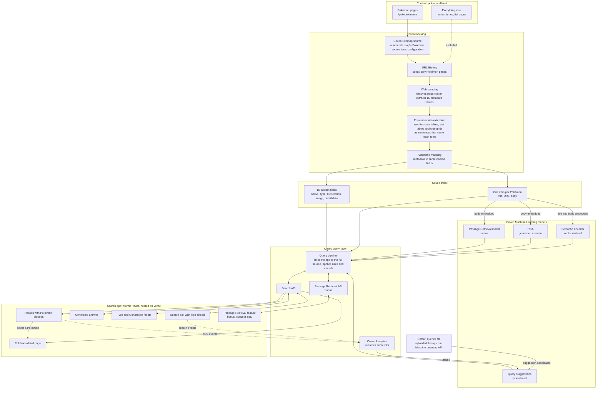

# Architecture

## Solution flow

This diagram shows the components of the solution and how they connect. Choices that are still open are marked "TBD".

## Decision summary

| Decision | Choice | Details |
|---|---|---|
| Search interface | Atomic React, revisited if too limiting | [Search interface](#search-interface-atomic-react) |
| Technology | TypeScript, with Python only for the Coveo extension | [Technology stack](#technology-stack) |
| Content scope | All 1,028 individual Pokémon pages, including incomplete new Pokémon | [Content scope](#content-scope) |
| Ingestion | Coveo Sitemap source with URL rules | [Coveo source](#coveo-source-sitemap) |
| Alternate forms | One item per Pokémon, with fields from the base form and all forms in the body | [One item per Pokémon](#one-item-per-pokémon) |
| Field extraction | XPath web scraping selectors scoped to the first form tab | [Web scraping](#web-scraping-and-fields) |
| Body text | Pre-conversion extension rewrites tables as sentences that name each form | [Body text reconstruction](#body-text-reconstruction) |
| Field mapping | Automatic mapping through `performFieldMappingUsingAllOrigins` | [Field mapping](#field-mapping) |
| Browser access | Anonymous search API key with the `pokebowl-search` search hub | [Search application connection](#search-application-connection) |
| Runtime | Node 24 | [Search application connection](#search-application-connection) |
| Application content | Dedicated `pokebowl-search` pipeline filters to the full source, and the test source is kept | [Limiting the application to the full source](#limiting-the-application-to-the-full-source) |
| Hosting | Vercel | [Hosting](#hosting) |
| Repeated platform work | Coveo APIs in place of repeated console steps | [Use of Coveo APIs](#use-of-coveo-apis) |
| Eval reference data | Sampled from pokemondb.net, with difficult cases verified by hand | [Eval reference data](#eval-reference-data) |
| Search behavior | Number lookups, Pokédex order on the home page, Best match as the default label, collapsed facets | [Search behavior](#search-behavior) |
| Page sizes | Atomic's `atomic-results-per-page` | [Visual direction](#visual-direction) |
| Empty and error views | Rendered from Headless search status | [Interface states and motion](#interface-states-and-motion) |
| Type-ahead | Query Suggestions model with a default queries file | [Query Suggestions](#query-suggestions) |
| Generated answers | Atomic's `atomic-generated-answer` with Semantic Encoder and RGA models | [Generated answers](#generated-answers) |
| Answer style | Custom prompt instruction on the RGA model | [Answer style](#answer-style) |
| Detail page | Query parameter URL, read through a separate Headless engine | [Pokémon detail page](#pokémon-detail-page) |

## Decisions

### Search interface: Atomic React

We will start with Coveo Atomic through its React wrapper. Atomic provides maintained components for search, facets, type-ahead and generated answers, which keeps the amount of custom interface code small.

The main cost is less control over appearance, because styling is limited to theming and the style hooks each component exposes. We considered building on Coveo Headless with custom components. That offers complete control but takes longer and adds more custom code to maintain. We can revisit this decision if Atomic proves too limiting.

**Coveo documentation:** [Atomic](https://docs.coveo.com/en/atomic/latest/), [Atomic React wrapper](https://docs.coveo.com/en/atomic/latest/usage/frameworks/atomic-react-wrapper) and [Headless](https://docs.coveo.com/en/headless/latest/). Atomic is built on Headless, and the comparison of effort between them is our judgment.

### Technology stack

| Layer | Choice |
|---|---|
| Language | TypeScript |
| Application | React and Vite |
| Search interface | `@coveo/atomic-react` |
| Custom interface | shadcn/ui and Tailwind |
| Unit and component tests | Vitest and React Testing Library |
| Browser tests | Playwright |
| Evals and data scripts | TypeScript run with Node |
| Coveo indexing extension | Python, tested with pytest |
| CI/CD | GitHub Actions |
| Coveo configuration export | Coveo CLI |
| Hosting | Vercel |

We use TypeScript for the application, tests and scripts. The one exception is the indexing extension, because Coveo runs extensions as Python. We considered Python for evals, mainly for its LLM evaluation libraries. We do not need those libraries because answers are checked against expected facts and citations. Eval speed depends on Coveo's API response times, so the language does not affect performance.

### Eval reference data

Reference data comes from pokemondb.net, the same site we index. A different source could disagree on types, forms or generations and produce false failures.

Because the reference data and the index share a source, the same extraction mistake could affect both. We reduce that risk by verifying difficult cases by hand. Raw HTML stays out of the repository, and only small derived reference data is committed.

### Content scope

The index contains every individual Pokémon page on pokemondb.net, including the newest Pokémon whose pages are still incomplete. Moves, types, list pages such as `all`, `national` and `shiny`, and all other site content are excluded. New Pokémon may have little body text and only a few entries under their Generation.

### Coveo source: Sitemap

We index with a Coveo Sitemap source because we already know exactly which pages we want and the site publishes a list of them. A Sitemap source visits only URLs listed in the sitemap and does not follow links. A Web source starts from one or more URLs and discovers pages by following links.

The sitemap covers the whole site and lists 12,923 URLs. URL rules narrow these to 1,028 individual Pokémon pages: the 1,025 numbered Pokémon and 3 new Generation 10 Pokémon that do not have numbers yet. Coveo applies the same rules to the sitemap URL, so the rules must explicitly include it.

**Benefits**

- **Less complexity:** there is no link traversal to reason about, so the result does not depend on how the site links its pages.
- **No starting-page problem:** a Web source's starting URLs must pass the source's filters. A list page used as a starting point would therefore be indexed, unless we supplied all 1,028 Pokémon URLs as starting URLs.
- **Verifiable outcome:** the expected item count is known, so a full crawl can be checked against it.

**Performance**

The performance gain is limited to crawling. Avoiding link traversal means the crawler does not need to visit pages only to discover links. Both source types are bound by the same crawl delay on the pages we index: 2 seconds between requests, as the site's `robots.txt` asks, or about 35 minutes for a full crawl. This estimate assumes Coveo requests only pages that pass the URL rules. The source type has no effect on search latency, which depends on the index and query pipeline.

**Alternatives considered**

- **Web source:** this is the better option when pages must be discovered or when one page must be split into sub-items. We need neither.
- **Push source:** this gives the most control over body text, but we would have to build and maintain a custom scraper.

**Coveo documentation**

- [Add a Sitemap source](https://docs.coveo.com/en/1967/): a Sitemap source crawls only listed pages, URL rules also apply to sitemap URLs, and the default delay between requests is 1,000 ms.
- [Add a Web source](https://docs.coveo.com/en/malf0160/): starting URLs are subject to the source's filters.
- [Sitemap source web scraping](https://docs.coveo.com/en/mahe0350/): Sitemap sources do not support sub-items.

The conclusions about complexity, the small crawl performance gain and the absence of any effect on search latency are our reasoning. The Coveo documentation does not compare the two source types on these points.

### Test source configuration

The source `pokemondb-test-charizard` indexes one page so that configuration can be tested without a full crawl. Charizard is used because its Mega forms have different Types and expose extraction mistakes.

| Setting | Value | Reason | Basis |
|---|---|---|---|
| Sitemap URLs | `https://pokemondb.net/static/sitemaps/pokemondb.xml` | This field expects the sitemap file itself. A normal web page can be read as an HTML sitemap, causing its links to be crawled. | [Add a Sitemap source](https://docs.coveo.com/en/1967/) |
| Exclusion rule | Regex excluding every URL except the sitemap and Charizard | URL rules apply to sitemap URLs as well as pages, so the sitemap must stay allowed. | [Add a Sitemap source](https://docs.coveo.com/en/1967/). Using a single exclusion regex is our approach because the console offered only exclusion rules. |
| Include all non-excluded pages | On | Provides the inclusion rule every URL must match, leaving the exclusion regex to narrow the result. | [Add a Sitemap source](https://docs.coveo.com/en/1967/) |
| Time between requests | 2,000 ms | The site's [robots.txt](https://pokemondb.net/robots.txt) asks for a 2-second delay. Coveo's default of 1,000 ms is faster than that. | Coveo default: [Add a Sitemap source](https://docs.coveo.com/en/1967/). The choice to follow robots.txt is ours. |
| Execute JavaScript on pages | Off | Coveo advises enabling this only for content rendered by JavaScript, and it can slow crawling. We confirmed that the Type and Generation markup is in the page's HTML. | [Add a Sitemap source](https://docs.coveo.com/en/1967/) and inspection of the Charizard page |
| Web scraping | [`web-scraping.json`](../configs/coveo/web-scraping.json) | Removes page navigation and sections from Moves onward, and extracts 16 metadata values from the page's first form tab. | [Web scraping configuration](https://docs.coveo.com/en/mc1f3573/) and [RGA content requirements](https://docs.coveo.com/en/nb6a0008/). Which sections to remove is our choice. |
| `performFieldMappingUsingAllOrigins` | True | Maps scraped metadata to fields with the same name. See Field mapping below. | [Add a Web source](https://docs.coveo.com/en/malf0160/), verified on our Sitemap test source |
| Content visibility | Everyone | The content is public and the application has no user sign-in. | Our decision |
| Extension | `pre-reconstruct-body` | Makes tables readable in the body. See Body text reconstruction below. | [Apply an extension](https://docs.coveo.com/en/1936/) |

### Full source configuration

The source `pokemondb-pokemon` is a duplicate of the test source and differs only in its exclusion rule, recorded in [`full-source.json`](../configs/coveo/full-source.json). Coveo's documentation recommends duplicating a source when two sources are similar, but does not list exactly what is copied, so each setting is checked after duplication.

The rule excludes every URL except the sitemap and pages directly under `/pokedex/`, then excludes the `all`, `national` and `shiny` list pages. We tested it against all 12,923 sitemap URLs. It keeps exactly the 1,025 Pokémon on the National Pokédex list and the 3 new Pokémon, and removes all moves and list pages.

### Web scraping and fields

[`web-scraping.json`](../configs/coveo/web-scraping.json) removes site navigation, the "Skip to main content" link, the Contents list and everything from the Moves section onward. It also extracts 16 metadata values, each stored in a field of the same name.

| Purpose | Fields |
|---|---|
| Search page | `pokemon_name`, `pokemon_type` (multi-value facet), `pokemon_generation` (facet), `pokemon_image` |
| Detail page | `pokemon_number`, `pokemon_species`, `pokemon_height`, `pokemon_weight`, `pokemon_abilities` (multi-value), `pokemon_hp`, `pokemon_attack`, `pokemon_defense`, `pokemon_sp_atk`, `pokemon_sp_def`, `pokemon_speed`, `pokemon_total` |

Selectors for Type, image and detail values read only the first form tab, so Mega forms cannot contaminate base-form values. All fields are strings. Stats are displayed rather than sorted, and Coveo requires non-string fields to be sortable. Stats are separate fields because a single list could lose order or repeated values. `pokemon_name` exists because the page title contains extra text that would look poor in results.

Field settings are in [`fields.json`](../configs/coveo/fields.json). Ranking and stemming are off because Coveo states that they have a significant performance cost. Free text search and caching are off because these values also appear in the body or have few distinct values. We can change this if evals show a need.

**Coveo documentation:** [Manage fields](https://docs.coveo.com/en/1833/) and [Web scraping configuration](https://docs.coveo.com/en/mc1f3573/). The rule against contaminating base-form values and the reasoning for separate stat fields are ours.

### Use of Coveo APIs

When a platform task would repeat the same manual step, we use a Coveo API instead of the console. This is faster, avoids entry errors and leaves a request body that can be reviewed in the repository.

| Task | API operation | Why | Request body |
|---|---|---|---|
| Create 12 detail-page fields | Field API, [create a batch of fields](https://docs.coveo.com/en/144/), run through Coveo's interactive API explorer while signed in | The detail page needs more data than the search page, and the same options applied to 12 fields would have been slow and error-prone to enter by hand | [`fields-batch-create.json`](../configs/coveo/fields-batch-create.json) |
| Upload Query Suggestions default queries | Machine Learning API, [Advanced Model Configurations](https://docs.coveo.com/en/qa5b0256/), `PUT configs/{configurationType}` with `DEFAULT_QUERIES` and `en`, run through Coveo's interactive API explorer while signed in | Coveo offers this configuration only through the API | [`query-suggestions-default-queries.csv`](../configs/coveo/query-suggestions-default-queries.csv) |

The first four fields (`pokemon_name`, `pokemon_type`, `pokemon_generation` and `pokemon_image`) were created in the console.

### Body text reconstruction

A Pokémon page contains valuable information in layouts that do not survive being flattened into text. A type effectiveness grid becomes a row of numbers such as `½ 2 2 ¼` with no attacking types, and a stat row becomes `78 266 360` with no labels. Generated answers read only the body text, in chunks of about 250 words, so this information would be lost or misleading.

Removing the content would have made the body cleaner but incomplete, so a pre-conversion indexing pipeline extension, [`reconstruct_body.py`](../configs/coveo/extensions/reconstruct_body.py), rewrites it before Coveo creates the body:

| Original content | Result in the body |
|---|---|
| Form tab labels | The Pokémon's name is added to labels that lack it, so "Attack Forme" becomes "Deoxys Attack Forme". Labels that already contain it, such as "Mega Charizard X" or "Alolan Meowth", are kept. |
| Pokédex data, Training and Breeding tables | One sentence per row, each starting with the form's full name: "Charizard weighs 90.5 kg (199.5 lbs).", "Charizard is 1.7 m (5′07″) tall.", "Charizard is Fire and Flying type.", "Charizard abilities: Blaze, Solar Power (hidden ability).", "Mega Charizard X Base Exp.: 285." A missing value becomes "Eternamax has no listed weight." |
| Type effectiveness grid | Sentences in the words people ask with: "Charizard is weak to Rock (4x), Water and Electric.", "Charizard resists …" and "Charizard is immune to Ground." These are followed by the detailed sentences, such as "Charizard takes 4x damage from Rock." Each form is named, and ability-specific grids name the ability. |
| Stat table | "Charizard base stats: HP: base 78, ranging from 266 to 360 at level 100." with the total |
| Local Pokédex numbers | Kept for the base form only, because they repeat for every form |
| Stat range explanation and "Additional artwork" labels | Removed, because they add no information once the stats are labelled |

Web scraping continues to remove site navigation and everything from the Moves section onward, and to extract the 16 field values.

**Alternatives considered**

- **Remove the content with web scraping:** simplest, but generated answers could not answer questions about type effectiveness or stat ranges.
- **Post-conversion extension:** Coveo warns that editing the body after processing can make search results inconsistent, because summaries and excerpts are already extracted.
- **Body mapping:** a mapping replaces the whole body, and the documentation shows no way to retain the original page text.
- **Push source:** provides full control but discards the crawling configuration we have validated and requires a custom scraper.

**Costs and safeguards**

The extension adds Python to the project and runs for every item. Coveo limits each extension to about 5 seconds per item. The slowest of our five sample pages took 224 ms locally. It is applied with **Skip extension** on error, so a failure leaves an item indexed with its original body and does not lose it. The extension is named `pre-reconstruct-body`, requests only the **Original file** item data and is applied at the **Pre-conversion** stage to all items. It was verified in Coveo on the test source: the Charizard body contains the rewritten sentences for all three forms, and all 16 fields still populate.

**Coveo documentation:** [Modifying item bodies](https://docs.coveo.com/en/2749/) states that changing `documentdata` in a pre-conversion script is "always preferable". [Add a body mapping](https://docs.coveo.com/en/1847/) describes how a mapping overrides the body, and [Python modules available to extensions](https://docs.coveo.com/en/116/) lists BeautifulSoup. [RGA content requirements](https://docs.coveo.com/en/nb6a0008/) states that only the body is embedded. [Indexing pipeline extension overview](https://docs.coveo.com/en/1556/) describes stages and timeouts. Coveo does not document whether the stream a pre-conversion script receives is the original page or the scraped page, so the script also removes navigation and the Moves section in case they are still present.

### Naming every form in the body

**Problem.** Generated answers mixed up forms. Asked "How much does Charizard weigh?", the answer gave Mega Charizard X's 110.5 kg instead of Charizard's 90.5 kg. The extension already named each form in its stat and type defense sentences, but it left each form tab's Pokédex data table as it was. Flattened to text, that table reads "Weight 110.5 kg (243.6 lbs)" with no form name, and it comes before the form's first named sentence. A chunk that holds this table can therefore hold only the previous form's name. Of 1,028 pages, 181 have forms whose Type, height, weight or abilities differ from the base form. In a test of 23 questions about such Pokémon, 5 answers gave another form's height or weight.

Three related gaps had the same root. In 47 pages, form labels such as "Normal Forme", "Attack Forme", "Combat Breed" or "Male" do not contain the Pokémon's name, so even named sentences did not say which Pokémon they were about. "Is Charizard weak to water?" got no answer, because the body said "Charizard takes 2x damage from Water" and never "weak". The Training and Breeding tables had the same unnamed layout as the Pokédex data table.

**Change.** The extension now writes every fact in each form tab as a sentence that starts with the form's full name, for every form including the base form. It adds the Pokémon's name, read from the page heading, to form labels that lack it, both in the tab list and in every sentence. It adds weakness, resistance and immunity sentences built from the same type grid as the damage sentences. The evolution chart, the "Changes" section and the "Pokédex entries" section are not changed. The application reads Pokédex entries from the stored page, and they are outside the form tabs. These sections, and the page introduction, keep the site's labels, so headings such as "Attack Forme" above a Pokédex entry still appear without the Pokémon's name in 46 of the 227 pages checked. The "Changes" section already names the Pokémon, as in "Thundurus (Incarnate Forme)".

**Coveo documentation:**

- [RGA content requirements](https://docs.coveo.com/en/nb6a0008/) states that RGA uses only the body, that the body is split into chunks of up to 250 words with up to 10% overlap, and that text in tables is embedded but parsed less predictably. It recommends content that is focused and written to answer questions.
- [Modifying item bodies](https://docs.coveo.com/en/2749/) states that changing `documentdata` in a pre-conversion script is preferable to changing the body later.
- [Create and manage RGA models](https://docs.coveo.com/en/nb6a0085/) and [Semantic Encoder models](https://docs.coveo.com/en/nb890247/) state that each model creates embeddings when it builds and rebuilds weekly. A rebuilt source therefore does not change answers until both models rebuild.
- [Inspect RGA chunks](https://docs.coveo.com/en/p5dc0110/) describes the Chunk Inspector, which shows how a model split an item into chunks.

**Our inference:** because a chunk can start anywhere in a section, a fact is only safe when its own sentence names the form, so every fact sentence repeats the name. Plain-language weakness sentences should match questions better than multiplier sentences, because the embeddings compare the question with the chunk text. Neither point is stated by Coveo, and only the answer evals after the model rebuild can show the effect.

**Alternatives considered**

- **One item per form:** gives each form its own body, but creates near-duplicate items, which the RGA guidance advises against, and Sitemap sources do not support sub-items. See [One item per Pokémon](#one-item-per-pokémon).
- **Name only the first sentence of each table:** shorter, but a chunk that starts after that sentence would again hold unnamed values.
- **A prompt instruction about forms:** Coveo allows a custom prompt, but it cannot add a name that the chunk does not contain. A prompt rule about forms was added later for answer style (see [Answer style](#answer-style)); it supports this fix but cannot replace it.
- **Rewriting the evolution chart as sentences:** it would help evolution questions, but it is a separate change and was left out of this fix.

**Cost.** Repeating the names makes the body longer. Over the 227 pages checked, the body grew by a median of 14% and at most 44%. The longest page, Rotom, has about 2,400 words, far below the limit of 1,000 chunks per item. The slowest page took 240 ms locally, against Coveo's limit of about 5 seconds per item.

**Checks.** `test_form_sentences.py` uses fixtures that copy the page structure and values of Charizard, Pikachu, Eevee, Deoxys, Tauros, Rotom, Meowth and Bulbasaur. It checks that every form's height, weight, Type, abilities and other rows appear in sentences that start with the form's full name, that every 250-word window around a form's weight names that form, that labels always include the Pokémon's name, and that the weakness sentences are correct. The extension was also run over 227 saved pages: the 189 pages with more than one form and a sample of single-form pages. It raised no errors, every form passed the same checks, and the 531 weakness sentences agreed with the damage sentences.

**Rollout order**

1. The user pastes the new `reconstruct_body.py` into the `pre-reconstruct-body` extension in the console.
2. Rebuild the single-Pokémon test source. In Content Browser, the Charizard quick view must show the sentences listed in [Indexing Expected Results](indexing-expected-results.md), and all 16 fields must still populate.
3. Rebuild the full source, keeping the 2-second crawl delay. It must still hold 1,028 items with all 16 fields.
4. The RGA model rebuilds when its configuration is saved, here the prompt instruction. The Semantic Encoder has no manual rebuild in the console, so it waits for its weekly rebuild unless Coveo changes the schedule (corrected on 2026-11-10; the earlier plan assumed both could be rebuilt by hand).
5. Run the answer evals with `npm run eval:answers`.

The answer evals reflect this change only after step 4, because the models answer from the embeddings of their last build.

The 16 field selectors read the Pokédex data and stat tables that the extension now replaces. The fields should still populate, because web scraping runs in the crawler and the extension runs later, in the indexing pipeline. Coveo does not document this order for the stream a pre-conversion script receives, so this is our inference. It is supported by the earlier test, where the six stat fields still populated after the extension had replaced the stat tables. Step 2 confirms it for the Pokédex data table before the full rebuild.

**Answer evals.** The answer set now asks base-form height and weight questions for Charizard, Venusaur, Lucario, Meowth and Tauros, and "What types is Charizard weak to?". The values of the other forms come from [`form-facts.json`](../evals/reference/form-facts.json). A base-form answer fails when it gives another form's value in place of the base form's value. An answer that gives both passes but is flagged for a person to check.

### Field mapping

We enable the source parameter `performFieldMappingUsingAllOrigins`, so scraped metadata maps automatically to fields with the same name. Without it, the 12 fields created through the API stayed empty even though the metadata had been extracted. With it, those fields populated without any per-field mapping rules. The setting does not carry over between sources: it was missing on the first full crawl, which left the 12 fields empty on all 1,028 items and required a rebuild, so it must be set on each new source before its first build.

**Coveo documentation:** [Manage source mappings](https://docs.coveo.com/en/1640/) describes automatic mapping to matching field names, and [Add a Web source](https://docs.coveo.com/en/malf0160/) describes this parameter for Web sources. The documentation did not confirm it for Sitemap sources, so we verified it on our test source. [Manage source mappings](https://docs.coveo.com/en/1640/) advises keeping this setting off for native sources, to avoid indexing irrelevant metadata and cluttering facets. We accept that because our scraping extracts only the 16 values we want. Automatically mapped fields have no rule on the source's mapping page, which is the likely reason the console lists these fields as unused in sources, although Coveo does not document that count.

### One item per Pokémon

Each Pokémon page becomes one item. Alternate forms such as Mega Evolutions appear as tabs on the same page, sometimes with a different Type. Type, image and other structured values are read only from the first tab, which is the base form. Charizard is therefore Fire and Flying, even though Mega Charizard X is Fire and Dragon. Alternate-form details remain in the body text, so they can still be searched and used in generated answers.

The cost is that users cannot filter by alternate form. We considered separate items for each form, but they create near-duplicate content that weakens generated answers.

**Coveo documentation:** [RGA content requirements](https://docs.coveo.com/en/nb6a0008/) recommends avoiding near-duplicate documents and notes that only the body field is embedded. Applying that guidance to alternate forms is our inference.

### Generation extraction

Each page states the Generation in a dedicated tag within its introduction, for example "introduced in Generation 1". We read it with a web scraping selector, because a selector is enough to capture a value that is already isolated in the page.

**Coveo documentation:** [Web scraping configuration](https://docs.coveo.com/en/mc1f3573/) describes CSS and XPath 1.0 selectors for extracting metadata, and states that extracted metadata needs fields and mappings before it can be used. The selector was verified on the test source.

## Search application connection

The application is a React and TypeScript page built with the official Atomic React wrapper, `@coveo/atomic-react`. It connects directly from the browser to Coveo with a search-only API key.

**Decision: use the Atomic React wrapper.** It lets result templates be written as ordinary JSX. The rejected alternative was using Atomic's web components directly, which adds no capability here and requires manual template and component setup.

**Decision: use one Anonymous search API key, `pokebowl-search-browser`, with the search hub `pokebowl-search`.** The rejected alternative was server-generated search tokens, which add a backend that public content does not need. Evals will use a separate key and search hub so their traffic stays out of the analytics used for model training.

**Decision: run on Node 24.** The current Atomic packages declare support for Node up to the 24 line. On Node 26, npm silently installs a much older Atomic release, so `.nvmrc` and the `engines` field pin the project to Node 24.

**Coveo documentation:** [Use API key authentication with the Search API](https://docs.coveo.com/en/105/) states that browser code may use only an Anonymous search key for public content, or a search token generated on a server. [Manage API keys](https://docs.coveo.com/en/1718/) lists the privileges of that template: Execute queries, Execute agent queries, and Analytics data push. [Atomic usage](https://docs.coveo.com/en/atomic/latest/usage/) states that the access token should enforce a search hub. [Use the React wrapper](https://docs.coveo.com/en/atomic/latest/usage/frameworks/atomic-react-wrapper/) states that the search hub must be set in the engine configuration, and that icons and labels must be served from the public directory.

**Facets:** Type uses alphabetical order. Generation uses natural order, `alphanumericNatural`, so Generation 10 follows Generation 9, which plain text sorting does not do.

**Search hub enforcement:** the browser key enforces `pokebowl-search` in Coveo. In a live test, requests sent with another search hub, or with none, were still routed to the `pokebowl-search` pipeline. [Ensure that authentication enforces search hub values](https://docs.coveo.com/en/las95231/) recommends enforcing the hub in the key or token. It does not state whether a client can override it, so this behavior is our observation. Evals and any query of the test source need a separate key.

**Our inference:** we do not treat the search hub as a security control, and all of this content is public. The wrapper documentation shows asset setup only for Create React App, so we copy the same folders into Vite's `public/` directory and confirmed the result in a browser.

## Limiting the application to the full source

The single-Pokémon test source stays in the organization for testing configuration changes, so the index holds 1,029 items and Charizard exists twice. A dedicated query pipeline, `pokebowl-search`, receives queries from any search hub containing `pokebowl-`, and a filter rule on that pipeline limits them to `pokemondb-pokemon`. The default pipeline has no condition and no filter rule.

**Decision: use a dedicated pipeline with a filter that includes the full source.** The rejected alternatives were:

- Deleting the test source, which removes our safe place to test configuration.
- Filtering in the application, which would not apply to requests made outside it.
- A filter rule on the default pipeline, which we applied first and then replaced. Its search hub condition would not have covered the separate eval search hub, and rules and models on the default pipeline apply broadly.

**Decision: do not create a Coveo project for now.** Projects group related resources and do not change search behavior, so one is not needed for the application to work. One can be added later without changing the configuration.

**Coveo documentation:** [Set up a query pipeline](https://docs.coveo.com/en/2757/) states that routing everything to the default pipeline works only for a single website or application. [Manage query pipelines](https://docs.coveo.com/en/1791/) describes dedicated pipelines with conditions and states that the default pipeline should have no condition. [Query pipeline routing](https://docs.coveo.com/en/1666) recommends condition-based routing on the search hub with positive operators. [Manage filter rules](https://docs.coveo.com/en/3410/) recommends filters that include content rather than exclude it, and states that filters alone do not prevent content from being exposed. [Filter: Query pipeline feature](https://docs.coveo.com/en/1440/) states that the constant part of the query is combined with AND and is unsuited to dynamic content. [Manage projects](https://docs.coveo.com/en/n7ef0517/) describes projects.

**Our inference:** the filter is a relevance control and not a security control, which is acceptable because all of this content is public. A query using the browser key with a different search hub returned no test source items, which suggests the key's search hub takes precedence, but we did not confirm this.

## Visual direction

The interface is polished yet playful: a calm, spacious structure with a friendly, tactile personality, because the application is themed around Pokémon but is shown to an enterprise audience.

- A warm off-white base keeps attention on the artwork.
- Each card's artwork sits on a tint of the Pokémon's Type, and dual-Type Pokémon blend both colors.
- Rounded type (Nunito, self-hosted), pill badges, and cards with a heavier bottom edge give a tactile feel.
- Type badge text is chosen for contrast, and a unit test holds every badge to at least 4.5:1.
- The layout, colors and components are original and do not copy official Pokémon styling.

Page sizes and result columns are defined once in `src/search/settings.ts`. Page sizes are multiples of the least common multiple of the two column counts, 4 and 6, so every row is full and the default stays at 12 cards. A product of the two counts would give 24. The content width is one named value, which also answers the earlier finding that very wide windows left half the screen unused. Phone layouts were dropped from scope at the user's request.

Our markup uses Tailwind and shadcn/ui. Atomic's components are styled through [theme variables and CSS parts](https://docs.coveo.com/en/atomic/latest/usage/themes-and-visual-customization/), because they use Shadow DOM and Tailwind classes cannot reach inside them. Result cards are rendered inside Atomic's Shadow DOM, so one shared stylesheet is adopted there instead of copying styles into each result. Our styles use no `!important`, and a unit test keeps it that way (PC-79, below).

Atomic's clear button only empties the text, so the application runs a search for everything, from the first page, when that button is used. Emptying the box by keyboard follows Atomic's behavior and waits for Enter, which avoids unrequested searches and false submit events in analytics. The search uses the `searchboxSubmit` event because Headless has no public event for clearing, and it fires only on the explicit button. Facets request up to a fixed ceiling so that a new Generation or Type is never hidden.

**Decision: one centered column.** The title, search box, filters, results and page numbers share one center line. Type and Generation are `atomic-popover` dropdowns in Atomic's `horizontal-facets` layout section, inside `main`, so results use the full content width and there is no left column. The rejected alternative was keeping a left column and only widening the page, which keeps the results off the page's center line. The trade-off is that filter values are one click away. Without a `facets` section, Atomic's layout already uses one main column between two gutters, so no grid override is needed.

**Decision: use Atomic's layout only where it fits, and our markup for the search box and controls rows (PC-79).** Atomic's [layout guide](https://docs.coveo.com/en/atomic/latest/usage/layouts/) describes the sections and the components each one holds, and says that the optional `search` section "will be aligned with the results". Its [theming guide](https://docs.coveo.com/en/atomic/latest/usage/themes-and-visual-customization/) documents theme variables, CSS parts, and building your own layout with CSS grid. Earlier, five `!important` rules forced the layout to fit our design. They are now gone:

| Earlier override | Replaced by |
|---|---|
| Center the `search` section and set its width, against Atomic's generated rule that left-aligns it at 80% width | The search box sits in our Tailwind row above `atomic-search-layout`, centered at the search width. The documentation marks the `search` section as optional |
| Make the `status` section a flex row instead of Atomic's grid, and remove the bottom margin Atomic gives each child | The summary, sort, page sizes, correction, lookup notice, breadbox and refine toggle sit in our Tailwind row inside `main`. Atomic's `status` grid has no place for page sizes, which the documentation puts in `pagination`, while our design keeps them beside the sort |
| Set the grid's side columns at desktop widths | The documented theme variable `--atomic-layout-spacing-x`, which Atomic's layout already uses for those columns |
| `position: relative !important` on the search box `wrapper` part | The same declaration without `!important`, because a CSS part rule from the page already wins over Atomic's styles inside the component |

Two rules that targeted Atomic's sections had no effect, because Atomic's own rules were more specific, so they were removed: a smaller gap below the filters and no top margin above the search box. The page measures the same as before at 1100, 1440, 1920 and 2560 px; every checked element kept its position and size.

**Our inference:** our markup for these two rows is the documented "own layout" approach applied to part of the page, while Atomic still lays out `main`, `horizontal-facets`, `results` and `pagination`. The rejected alternative was raising selector specificity to beat Atomic's generated rules, which removes `!important` but still depends on Atomic's undocumented selectors. Replacing `atomic-search-layout` entirely was not considered, because it would also drop Atomic's mobile handling of facets.

Atomic shows the refine toggle instead of the sort dropdown below its mobile breakpoint only inside its `status` section, so our row does the same with Tailwind's `lg:hidden` and `max-lg:hidden`. Tailwind's `lg` breakpoint is 1024px, the same as Atomic's default mobile breakpoint.

**Rules kept, with no documented alternative:**

- Atomic's layout stylesheet gives each popover in `horizontal-facets` a right margin of 0.5rem, which would put the filter row off center. No variable or option controls it. Our rule sets it to 0 with one more element in the selector than Atomic's rule, and the row uses a `gap` instead.
- Additions that Atomic does not set, and so do not override anything: centering and spacing the filter row, and a bottom margin below the pager.

**Decision: use Atomic's `atomic-results-per-page` for page sizes.** It hides itself on errors and empty results, so we do not maintain that logic. It replaced a custom dropdown built on Headless and shadcn/ui. It shows buttons instead of a dropdown, and it is styled through CSS parts to match the pager.

**Decision: remove unsupported sort and page size values from the URL before the application starts.** Atomic restores URL state as written. A sort that Coveo rejects makes Atomic remove the sort control, which leaves no way to change it, and a page size that is not offered leaves rows partly empty. `src/search/urlState.ts` keeps only the offered values and leaves other entries unchanged.

**Rejected alternatives:** a restrained product look, which undersells the theme, and a dark editorial look, which suits the artwork less well on tinted cards.

## Search behavior

Type and Generation filters are closed until a person opens their dropdown, so no collapse setting is needed.

Three behaviors are added on top of Coveo's default relevance search.

**Decision: a number-only search is a Pokédex lookup.** A query that is only a number, such as `3` or `#25`, returns the one Pokémon with that Pokédex number, and a notice above the results says so. Without this, a number matches every occurrence of that number in the body text, including stats and Generation labels, so `3` returned 806 Pokémon. The rejected alternative was boosting the exact match and keeping the other results, which leaves the same noise below it. Text searches such as `Generation 3` are unchanged.

**Decision: the home page is in Pokédex order.** An empty query has nothing to rank on, so Coveo's order looks arbitrary. When no search text exists and no other sort was chosen, the application sorts by Pokédex number. New Pokémon whose number is `???` sort last. The rejected alternative was a curated list, which needs maintenance and does not help browsing.

**Decision: Best match follows the common industry pattern.** Relevance is the usual default sort, under names such as Best Match or Featured ([Elastic](https://docs-v3-preview.elastic.dev/elastic/docs-builder/docs/3915/reference/search-ui/solutions-ecommerce-search-page.md), [Algolia](https://www.algolia.com/blog/ux/best-practices-for-site-search-ui-design-patterns)). With no search text there is nothing to rank, so the default order is Pokédex order. Baymard warns that a label should not suggest a different order from the one applied ([Baymard](https://baymard.com/blog/default-sort-type)). That is the tradeoff here, because Best match and Pokédex number give the same order on the home page. No single authoritative standard exists for this case.

**Decision: add query correction and a sort control.** Coveo lists these among standard search interface components. The sort options are best match, Pokédex number and name. `pokemon_number` and `pokemon_name` have the **Sort** option enabled in Coveo. We did not enable **Use cache for sort**, because a sorted query already takes about 22 milliseconds in the search API.

**Coveo documentation:** [Modify requests and responses](https://docs.coveo.com/en/atomic/latest/usage/atomic-modify-requests-responses/) describes the request hook, and advises limiting it to search requests and coding defensively. It recommends the Headless advanced query action for setting `aq`, without giving a reason. [Ensure that your search interfaces contain standard components](https://docs.coveo.com/en/mc2g0332/) covers query correction and sorting. [Manage fields](https://docs.coveo.com/en/1833/) states that the Sort option needs no rebuild, though a delay may occur.

**Our inference:** we use the request hook despite that recommendation, because the number lookup must also clear the text query in the same request, and the advanced query action cannot do that. The partial-name search below uses the same hook for a related reason. The search box keeps the text the person typed. Whether analytics keep it has not been verified, and Coveo's documentation suggests the lookup may be recorded with empty text. Check it in Usage Analytics.

### Partial-name search

**Problem.** Searching `char` returned only 5 items, with Charizard last and Charmander missing. Coveo matches whole words, and `char` is not a whole word in most Pokémon names. A ranking rule can only reorder results that a query already returns, so finding these names needs a way to include them.

**Decision: match the start of the name for one-word searches, and rank those names first.** The request hook in `src/search/queryRewrite.ts` handles a search that is one word of two or more Unicode letters or digits and is not a Pokédex number lookup. It keeps `q` as typed and adds three things:

- `wildcards: true`
- `dq: @pokemon_name=char*`, which includes the names that start with the word
- `$qre(expression:'@pokemon_name=char*',modifier:'300')` in `aq`, after any existing `aq`, which ranks those names first

The boost is `NAME_PREFIX_BOOST` in `src/search/settings.ts`. Multi-word searches, empty searches and number lookups do not change. Only letters and digits qualify, so typed text cannot add query syntax to the field expression. This is an application change only, and needs no Coveo configuration.

**Decision: `dq` repeats the active filters.** With only the name match in `dq`, selecting Type Fire for `char` still returned Charjabug, which is Bug and Electric: 6 results, against a Fire facet count of 5. Coveo documents the combined expression as `((q AND lq AND aq) OR dq) AND cq`. Our inference, which the documentation does not state, is that facet selections apply only to the first group, so an item that matches `dq` skips them.

The user decided that selected facet values must be added to `dq`, because the alternatives give poor search behavior: a filter must always filter, and a partial name such as `char` with Type Fire must still find Charmander.

**How this was found.** The benchmark missed the defect, because it selects no facets. A browser test that selected a facet caught it.

The hook now builds the filter from the request, for every facet in `facets` rather than a fixed list:

| Filter state | Added to `dq` |
|---|---|
| Selected values | `@pokemon_type==("Fire","Bug")`, any value of one facet |
| Excluded values | `NOT @pokemon_type==("Bug")` |
| More than one facet | One expression each, so all must match |
| Existing `aq` | `(aq)`, the expression before the boost |

For example, `char` with Fire in Generation 1 sends `@pokemon_name=char* @pokemon_type==("Fire") @pokemon_generation==("Generation 1")`. Live results: `char` with Fire returns 5 results, all Fire, including Charmander. Fire or Bug returns 6, adding Charjabug. Fire with Generation 1 returns 4. Excluding Fire returns Charjabug and Thundurus. The interface does not enable facet exclusion, so exclusion was tested through the Search API only.

**When `dq` is left out.** A filter that cannot be repeated exactly removes `dq` for that request, and the boost stays. The person then sees whole-word matches only, which is better than showing an item the filter should remove. This applies to:

- A value containing a double quote or backslash. Values can arrive through the URL, so this also blocks query syntax injection.
- A field name that is not letters, digits or underscores.
- A value state other than selected, excluded or idle.
- Facets that require every selected value (`resultsMustMatch: allValues`).
- Active range, hierarchical or automatic facets.

The application uses only Type and Generation facets with quote-free values, so none of these apply today. The same benchmark sends no active facets, so its results below are unaffected.

**Escaping.** Coveo's documentation does not describe an escape for a double quote inside a quoted field value, so we tested it. `@pokemon_name==("Fi\"re")` returned a 400 error, and a backslash before a quote still ended the value, so a crafted value could add its own expression. A no syntax block is not a substitute: `@pokemon_type==<@- Fire -@>` returned 82 items, because Coveo removes special characters in the block and exact matching is not preserved. Values without quotes work as they are, including `Flabébé`, `Farfetch'd` and `Type: Null`.

**Known limit, not verified:** a value that Coveo ML automatically selects on the server would not appear in the request and could not be repeated in `dq`. We have no facet ranking model, so this does not apply today.

**Did you mean.** `char` shows "Did you mean: chart". This predates the change: the Search API returns the same correction for `char` with and without the rewrite. It comes from the `queryCorrection` setting that Headless sends. We left it unchanged.

**Benchmark method.** `npm run eval:prefix-benchmark` runs each setting against live Coveo through `rewriteSearchBody`, sequentially and paced, with analytics capture off. It writes `evals/reports/prefix-benchmark.json`. It uses 171 queries: the 123 reference queries, 18 bare Type queries such as `dragon`, and 30 three-letter prefixes shared by at least three names, sampled evenly. Queries the rewrite does not affect are sent once and are not timed, which leaves 93 timed queries. The benchmark does not select facets. Facet behavior is covered by the unit tests and browser tests.

The name-first measure asks whether the top min(relevant count, 12) positions are all relevant. MRR only sees the first relevant result, so it cannot detect a mixed order.

| Setting | Overall MRR (123) | Partial MRR | Partial name-first | Short-prefix name-first | Short-prefix R@12 | Bare Type P@12 | p95 |
|---|---|---|---|---|---|---|---|
| Before this change | 0.901 | 0.646 | 56% | 10% | 0.178 | 0.931 | 195 ms |
| Prefix match, no boost | 0.938 | 0.927 | 88% | 73% | 0.950 | 0.931 | 192 ms |
| 50 | 0.942 | 0.958 | 94% | 77% | 0.967 | 0.931 | 189 ms |
| 100 | 0.947 | 1.000 | 94% | 77% | 0.978 | 0.931 | 185 ms |
| 150 | 0.947 | 1.000 | 100% | 87% | 1.000 | 0.931 | 188 ms |
| 200 | 0.947 | 1.000 | 100% | 90% | 1.000 | 0.931 | 190 ms |
| 300 | 0.947 | 1.000 | 100% | 97% | 1.000 | 0.931 | 189 ms |
| 500 | 0.947 | 1.000 | 100% | 97% | 1.000 | 0.931 | 202 ms |
| 1000 | 0.947 | 1.000 | 100% | 97% | 1.000 | 0.931 | 198 ms |

Latency was measured from a developer machine, not a hosted site, and the differences between settings are within normal variation. Among bare Type queries, only `dark`, `dragon` and `rock` changed in the top 3, and precision did not change. The other reference categories did not change.

**Why 300.** It is the lowest tested setting that reaches the best score on every measure. Stronger boosts add nothing.

**Target not met.** The overall MRR target of 0.95 is missed, at 0.947. The remaining gap is in descriptive queries (0.717) and in Generation (0.950), ability (0.922) and species (0.922) queries. One-word prefix matching does not improve these, and we did not tune the benchmark to hide this.

**Re-run after the full source rebuild (November 9, 2026).** The new body text names every form and adds "is weak to" and "resists" sentences. The choice of 300 still holds: it remains the lowest setting with the best score on every measure, and overall MRR is 0.947 at every setting from 100 up. Bare Type P@12 fell from 0.931 to 0.875 at every setting, including the setting before this change, so the drop comes from the body text, not from the boost. Our inference is that a bare Type word such as `flying` or `ground` now ranks higher for Pokémon whose matchup sentences name that Type, because each matchup is now stated twice ("takes 2x damage from" and "is weak to"): `flying` returns Centiskorch and Sizzlipede, which are weak to Flying. Descriptive queries moved from 0.717 to 0.700, ability from 0.922 to 0.900, and Generation from 0.950 to 1.000.

**Rejected alternatives**

- **Boost 100, the first recommendation.** MRR is perfect, but `char` still places Thundurus and Magmar among the Char- names.
- **Sending `char*` as `q`.** It matched all 1,028 items and changes the text sent to generated answers.
- **No `wildcards` flag, or the `*=` form without it.** Live tests showed no expansion.
- **`applyToEveryResults` or `isConstant` at modifier 100.** Neither changed the order. `isConstant` should also stay false for an expression that depends on user input, because it asks Coveo to cache the result set.
- **Headless advanced query action, or a pipeline `queryParamOverride`.** The expression comes from the typed text in the same request and also needs `wildcards`. A pipeline override sets one fixed parameter per statement.
- **Leaving out `dq` whenever a facet is selected.** Rejected by the user. It keeps filtering correct but loses names: `char` with Type Fire would no longer return Charmander.
- **Accepting that facets do not filter the added names.** Rejected by the user. It leaves a visibly broken filter, and a filter must always filter.

**Coveo documentation**

- [Wildcards](https://docs.coveo.com/en/1580): wildcards are disabled by default in the Search API, and isolating the data in a dedicated field is advised. At least two characters must precede a wildcard, an overly broad expression returns `WildcardTooGeneral`, and expansion is limited by default to the first 512 terms found alphabetically.
- [Query expressions](https://docs.coveo.com/en/2830.md): the combined expression is `((q AND lq AND aq) OR dq) AND cq`, and `cq` and `dq` should never be used for features that affect ranking.
- [Query ranking expressions](https://docs.coveo.com/en/1462.md): a modifier is typically between -100 and 100 "unless you want to completely override the index ranking scores", and a modifier of 100 adds 1000 to the score.
- [Modify requests and responses](https://docs.coveo.com/en/atomic/latest/usage/atomic-modify-requests-responses/): the request hook should be coded defensively, for example with `try...catch`, and the Headless advanced query action should be used for `aq`.
- [Using facets](https://docs.coveo.com/en/1571/): each selected value is a filter on top of other selections, results contain at least one selected value of a facet, and exclusion is available when enabled.
- [Facet controller in Headless](https://docs.coveo.com/en/headless/latest/reference/interfaces/Search.Facet.html): `toggleSelect` and `toggleExclude` change a value's state. Coveo's pages we read do not describe the `currentValues` request format, so we confirmed it from the request Atomic sends and from the Headless type definitions.
- [Special characters](https://docs.coveo.com/en/2744): `==` is an exact match operator, `NOT` excludes, and a list in parentheses acts as OR. The page shows the list with `=`. We use it with `==`, which we confirmed live.
- [No syntax blocks](https://docs.coveo.com/en/1454/): `<@- -@>` protects variables by removing special characters from them.
- [Query parameter overrides](https://docs.coveo.com/en/1491): an analytics event's `advancedQuery` should be set to the `aq` value of the corresponding query, and one statement overrides one parameter. The same page also describes a comma-separated list of overrides in its syntax section, which conflicts with that rule.

**Our inference**

- Using `dq` only for inclusion and putting the boost in `aq` follows the guidance on ranking features.
- 300 is the deliberate case of overriding index ranking scores: a name that starts with the typed word should come before a match in the body text.
- We differ from the advanced query recommendation because `dq` and `wildcards` must be set with `aq`, from the typed text, in the same request. The hook keeps the restriction to search requests and the `try...catch`.
- **Known limit, not verified:** analytics may record a different `aq` from the rewritten request, because the hook changes the request after Headless builds it. Coveo's guidance is that the two should match. Check this in Usage Analytics.
- The two-character minimum in our rule matches Coveo's wildcard requirement.

**Questions the panel may ask**

- **Why does `dq` need the facet values at all?** Coveo documents the query expression as `((q AND lq AND aq) OR dq) AND cq`. In our tests, items matched through `dq` skipped facet filtering. The link between the two is our inference from testing: we did not find Coveo documentation that states it.
- **Why is the boost in `aq`, with `dq` used only for inclusion?** Coveo says `cq` and `dq` should never be used for features that affect ranking, and recommends the basic or advanced expression instead.
- **Why is the modifier 300, above Coveo's typical -100 to 100?** Coveo's `$qre` documentation allows a larger value when you want to completely override the index ranking scores, and this is that deliberate case. The benchmark chose it as the lowest tested setting that reaches the best score on every measure.

## Hosting

**Decision: host the application on Vercel.** It connects to the GitHub repository, deploys when changes merge, and needs little setup for a static Vite application. The rejected alternative was Netlify, which offers similar deployment features. The application is a static page that calls Coveo from the browser, so it needs no server. The Coveo organization ID and the search-only key are set as build variables in Vercel, and they reach the browser by design. `src/main.tsx` names exactly these two values when it reads them, so Vite inlines only them. Passing all of `import.meta.env` would also inline Vercel's own `VITE_VERCEL_*` build values, such as the commit message and author name; a production build with marker values in those variables confirmed they are absent.

## Query Suggestions

Query Suggestions is the type-ahead list in the search box. Its model learns from analytics of what people searched and clicked, and it does not read the index. This application has no real users, so the model has no history to learn from.

**Decision: pre-populate the model with a default queries file, uploaded through the Advanced Model Configurations API.** This is the method Coveo documents for test and low-traffic environments. Enrichment comes after this baseline works, and only if it adds value.

**First file:** `configs/coveo/query-suggestions-default-queries.csv`, with 2,234 queries generated from values in the index: 1,028 Pokémon names, 18 Types, 10 Generations, 178 Type pairs, 284 abilities and 716 species. Each query other than a name was tested against the index with analytics capture off, and 10 were dropped because no top-12 result carried the value. The first file carried no importance values, because any popularity numbers would be invented. Longer natural-language questions were left out, because the purpose of this feature is completing what a person types. A few could be added after generated answers work.

**Rejected as the first step: scripted sessions that search and click through the application.** The events would be correctly formed, but the traffic would be synthetic, and scripted volume would still be far below what the model needs to learn well. It was kept as a fallback in case the model could not become active, and was not needed.

**Rejected: scripted calls directly to the Search and Analytics APIs.** Our code would have to reproduce the event format that Atomic already produces.

**Possible enrichment, after the baseline:** importance values based on real query counts once they exist, more descriptive searches informed by general search practice, and removal of poor suggestions with a blocklist.

**Coveo documentation:** [Troubleshoot Query Suggestions models](https://docs.coveo.com/en/q6qc0388/) states that a model needs approximately 10,000 search events to produce learned suggestions, and that a test or low-traffic environment can be pre-populated with a default queries file. [Set advanced QS model configurations](https://docs.coveo.com/en/qa5b0256/) describes the file: a UTF-8 CSV without headers, at most 5,000 queries per language, with an optional importance value. [Create and manage a QS model](https://docs.coveo.com/en/3398/) states that a model needs at least 100 events to provide recommendations, and that Test configuration mode is available only in sandbox organizations. [Reviewing query suggestion candidates](https://docs.coveo.com/en/2010/) states that, at low volume, a query qualifies after one search followed by a click.

**Our inference:** Coveo does not state whether a model becomes active with almost no analytics, or whether uploading the file triggers a rebuild. Our model did become active. Choosing names and descriptive searches for the file is a product decision.

**Learning interval:** a 1-month data period with daily builds, which Coveo's table lists as a valid pairing. We changed it from the default so that a rebuild picks up the uploaded file soon after upload. Immediately after the upload, the Query Suggestion API returned only a learned query. After the rebuild it returned the file's queries, which supports our inference that the file takes effect on a rebuild. Coveo does not document this.

**Ranking:** the user chose to add the file's optional importance column by category, so that Pokémon names come before abilities and species. The first upload had equal importance, and `char` listed `charm` first and Charizard seventh. The ranked file has 2,236 queries, with importance 1000 for Pokémon names, 500 for Types and Generations, 200 for Type pairs, and 100 for abilities and species. These values rank categories and do not claim to be popularity. Upload of the ranked file is pending.

### In production

A client deployment would go further than this baseline:

1. **Log real queries and clicks.** The application already logs them through Atomic. Each model rebuild then learns from real behavior, and the default queries file becomes a starting point that real data overtakes. Coveo recommends a [data period that covers at least 10,000 queries](https://docs.coveo.com/en/3398/), with 3 months and weekly rebuilds as its recommended setting.
2. **A/B test before full rollout.** Coveo's [leading practice](https://docs.coveo.com/en/l1mf0321/) is to test a new model on a share of the traffic and compare search performance with and without it.
3. **Monitor suggestion quality.** Report on [searches that came from a suggestion](https://docs.coveo.com/en/2010/), which have the `omniboxAnalytics` event cause, and use the click-through measures in the [model card](https://docs.coveo.com/en/p2ac0141/).
4. **Maintain the suggestions.** Use a [blocklist](https://docs.coveo.com/en/qa5b0256/) for unwanted terms. The [model card](https://docs.coveo.com/en/p2ac0141/) notes that the model can keep suggesting queries for removed content until it retrains.
5. **Keep test traffic out.** Evals and monitoring use a separate search hub so they do not train the model.

## Pokémon detail page

**Decision: each result opens a detail page in this application, at a URL such as `/?pokemon=Mr.%20Mime`.** The page shows artwork, name, number, Types, Generation, species, height, weight, abilities and base stats, and links to the source page on pokemondb.net. The user confirmed this content.

A query parameter needs no rewrite rules on Vercel and does not interfere with the `#` state that Atomic keeps in the URL. The rejected alternative was a path URL such as `/pokemon/mr-mime`, which needs hosting rewrites.

The page reads one item through a separate Headless engine with analytics off, using an exact match on the name. Coveo's `==` operator treated `?` and `*` as wildcards in our testing, so the page also checks that the returned name equals the requested name. Pokémon with `???` as their number hide it and state that base stats are not available. Result cards use Atomic's link templates, so a card click still logs Atomic's click event.

Not confirmed: real artwork on the page, and that the click event reaches Coveo in production.

## Interface states and motion

**Decision: the no-results and error views are rendered from Headless search status, in place of `atomic-no-results` and `atomic-query-error`.** Atomic's error view prints the organization endpoint and offers no retry, and its no-results text cannot vary by query, and its documented parts can restyle these but cannot change them. The rejected alternative was restyling Atomic's parts, which would keep the service URL visible. Atomic still marks the page with its no-results and error classes, which center the message on the page.

**Decision: first-load placeholders match the real result cards.** Atomic's placeholders have a generic shape and cannot be reshaped through its parts, so result cards use a matching placeholder. The filter row uses the `atomic-popover` placeholder, sized to the real control.

**Decision: one solid focus outline, using the foreground color with an offset, for all controls.** Atomic's ring variable points to the same token. The former translucent ring measured 1.69:1, below the 3:1 that WCAG 1.4.11 requires.

**Motion is limited to feedback:** card lift and press, control color transitions, and an opacity fade on new results and opened facets. It uses transforms and opacity only, so it cannot move the layout, and it is turned off when a person requests reduced motion.

**Atomic detail:** the type documentation lists the search box part as `input`, but the rendered part is `textarea`, so the styles target `textarea`.

**Finding to keep in mind:** with the Semantic Encoder active, a nonsense text query can still return results, so a no-results page is now reached mainly through number lookups and filters.

**Pokédex entries:** the detail page shows the most recent entry of the base form, with its game names. Other entries sit behind "More entries", grouped by distinct text with every game that shares it, and alternate forms are grouped under their names. The text comes from the item's stored page through the Headless [Quickview](https://docs.coveo.com/en/3311/) controller on the analytics-off lookup engine. The page is parsed with `DOMParser` and only text is read, because the stored HTML contains scripts and must never be inserted into the page. The rejected alternatives were showing the body field, excerpt or summary, which have no structure, and adding entries as index fields, which needs a source rebuild. The section depends on the markup of the source page, so it hides itself when the page has no entries, when parsing finds nothing, or when the content does not arrive within a named timeout, because Headless has no failed state for this request. A visible line credits the Pokémon games and Pokémon Database. Whether the pokemondb.net terms allow quoting this text has not been checked.

**Links to search:** Type badges and the Generation value open the search page filtered by that value. The links are built with Headless `buildSearchParameterSerializer`, which writes the URL format that Atomic reads. A browser test confirms that the filter is applied.

## User decisions on states and links

- **No-results and error screens:** approved as worded. The text is in `src/search/SearchStateMessage.tsx`.
- **Generated answer citations:** they stay on pokemondb.net, because in enterprise search a citation sends a person to the full source.
- **Detail page source link:** it reads "Learn more about" followed by the Pokémon's name, and opens the pokemondb.net page.

## Semantic Encoder results for unrelated queries

**Decision: keep the Semantic Encoder's similarity threshold at its current value, and accept that some nonsense queries return Pokémon.** The user accepted this as a tuning tradeoff for an application that is not yet a production system.

**What happens.** The query `qqqzzzxxxvvv` matches no text in the index, but returns 8 Pokémon such as Qwilfish. The Search API debug report shows each of those results carries the Semantic Encoder's vector ranking function, with a cosine similarity of about 0.81 against a minimum of 0.8. Unrelated text such as `asdfghjkl`, `lorem ipsum dolor`, `hello world` and `pizza` returns no results, so the no-results state still appears.

**Coveo documentation:** [About Semantic Encoder (SE)](https://docs.coveo.com/en/nb6a0483/) states that the model retrieves items that are semantically similar to the query alongside lexical search, and that the results show the most relevant items from both. [Create and manage SE models](https://docs.coveo.com/en/nb890247/) states that only items above a minimum similarity threshold are retrieved, and warns that a threshold set too high can exclude relevant items, while one set too low can retrieve items that are not relevant.

**Measurement.** Similarity scores were read from the debug ranking information on 2026-11-09, with analytics capture off:

| Queries | Similarity of returned items |
|---|---|
| Nonsense and off-topic results (`qqqzzzxxxvvv`, `car insurance`) | Up to 0.817 |
| Relevant results for the 13 descriptive eval queries | Lowest 0.804, 10th percentile 0.812, median 0.828 |

**Our inference.** The two ranges overlap. A threshold of about 0.82 would remove these nonsense results but also drop many relevant results for descriptive queries such as `fire fox` and `bug dark`, which are already the weakest category. For the presentation, this shows hybrid search at work: the vector side offers the nearest Pokémon for unclear text, while clearly unrelated text returns no results.

**Rejected: raising the similarity threshold.** It trades a cosmetic issue for worse results on real descriptive queries.

**Not investigated further:** `zzqxvkjw` and `xkcd blorp` return results without a vector score, so a lexical match brings them in. It does not affect real queries.

**Production path:** tune the threshold against real query logs and a labelled set that includes negative queries, rather than a small sample.

## Generated answers

**Decision: use Atomic's `atomic-generated-answer` at the top of the results section, with `collapsible` on.** The answer sits below the fixed controls row and above the result cards. It keeps Atomic's disclaimer, citations, feedback and copy actions, and is styled only through its documented CSS parts.

**Coveo documentation:** [Configure a search interface for RGA](https://docs.coveo.com/en/nb6a0037/) states that an Atomic page must include this component, that the component does not appear when no answer is generated, that the hosted builders place it at the top of the results, that a disclaimer is part of the component, and that results not sorted by relevance may produce no answer. [RGA content requirements](https://docs.coveo.com/en/nb6a0008/) strongly recommends a disclaimer. The installed Atomic 3.65 source requests `text/markdown` first, with `text/plain` as the fallback, so the association's rich text option is used.

**Our inference:** `collapsible` keeps a long answer from pushing the results far down. We left the no-answer slot empty, so a query without an answer shows normal results and no empty box. An answer that arrives still moves the cards down, because the page cannot know in advance whether an answer will exist.

**Observed behavior, November 9, 2026:**

- With Best match, `what type is charizard` and `which pokemon evolves into charizard` streamed answers with a citation to the Charizard page.
- After changing that first search to Name A to Z, the answer disappeared and the sorted results stayed, with no error. This matches Coveo's documentation.
- The search response carries a `generativeQuestionAnsweringId` for a text query even when the request does not include the answer format parameter. Coveo does not state when an answer counts against the allowance.

**Testing:** every browser test uses a stubbed answer stream from `e2e/fixtures.ts`, so the suite reads no real answers from the allowance. The real end-to-end checks above were run separately.

The type-ahead panel now shares the search box's edges, border and radius, and uses the main text color, through Atomic's `suggestions-wrapper` and `query-suggestion-text` parts.

## Answer style

**Problem.** Answers read like copies of the page, not summaries. In the November 9 report, 24 of 25 answers started with a Markdown heading, 10 referred to "the documentation", and "What is the difference between Charmander and Charmeleon?" listed every field of both pages, including nine regional Pokédex numbers.

**Decision: a custom prompt instruction on the RGA model, applied by the user on 2026-11-10.** The text is in `configs/coveo/rga-prompt-instruction.txt` (1,885 of 2,000 characters). It asks for a direct answer in the first one or two sentences, then only the relevant details, with short headings and bullet points for answers with several parts. It keeps the rules from Coveo's default template that apply here: use only the provided content, no opinions or speculation, decline when uncertain or off topic, and the safety rules. It adds two rules for errors the evals found: give the base form's value unless another form is named, and list a type as a weakness only at 2x or 4x damage. The user chose this version over a shorter first draft without headings, because answers should keep useful detail and stay grounded in cited content.

**Coveo documentation.** [Create and manage RGA models](https://docs.coveo.com/en/nb6a0085/) states that the instruction is set under Configuration, Prompt enhancement, is limited to 2,000 characters, is added to the base prompt rather than replacing it, applies to every pipeline that uses the model, and triggers a model rebuild when saved. It warns that a custom instruction "isn't guaranteed to be followed fully or consistently", is not covered by Coveo's automated tests, may carry prompt injection risk, and should be retested because the base prompt changes often. [Improve your RGA implementation](https://docs.coveo.com/en/p5db0550/) lists the instruction as a way to adjust tone or style. [About RGA](https://docs.coveo.com/en/n9de0370/) states that the language model uses only the chunks in the prompt, and that Coveo returns citations for them.

**Our inference.** Coveo attaches citations from the chunks it used, so the prompt cannot add citations. Asking that every statement come from the provided content keeps each statement traceable to a cited page. The instruction also reaches the detail page bubble, which uses the same model.

**Rejected alternatives**

- **The Headless `answerStyle` option.** Older Atomic and Headless versions offered default, bullet, step and concise styles. Headless 3.58 no longer has it; the only client setting is plain text or Markdown.
- **Knowledge Hub answer rules.** [Create rules for generated answers](https://docs.coveo.com/en/p5db0039/) states that only blocking rules exist, which stop an answer for a word or phrase. They cannot change style, and the Knowledge Hub is an early-access beta.
- **The shorter first draft.** It removed headings and kept answers to one to three sentences. The user rejected it as too thin.

**Verification.** The answer evals add checks for answer length, "documentation" wording and wrong weaknesses, are applied first to the November 9 report as the baseline, and run again once the RGA model is active.

## Ask about this Pokémon

**Decision: the detail page has a compact speech bubble, opened from a wobbling Pokéball at the top-right corner of the main card.** The user chose this over a card on the page, then over a chat window, and placed the Pokéball in the card so it is visible on load without scrolling. A fixed bottom-corner launcher was rejected for being less visible. The bubble stays closed on load, shows three suggested questions defined once in `src/search/settings.ts`, and shows one thing at a time. Picking a question replaces the questions with its answer, while the Pokéball wobbles faster and the bubble says it is thinking. "Ask something else" returns to the questions. There is no greeting, header or message history.

An answer is generated only when a person picks a question. Generating on load was rejected, because it would use the generative allowance on every view and add seconds of waiting. Free-text input was rejected, because question wording strongly affected speed and quality.

Only one `atomic-generated-answer` exists at a time, in an `atomic-search-interface` with a search engine created for that question, so an earlier answer cannot remain visible. This keeps Atomic's citations, disclaimer, feedback, copy and Markdown rendering, styled through CSS parts. Only its header and citations label are hidden to keep the bubble quiet. The user chose to keep the feedback buttons visible, as on the search page. The rejected alternative was the Headless `GeneratedAnswer` controller, which would have required rebuilding those features and rendering Markdown safely. The engine sends the question as `q` and an exact name match as `aq`, does not write to the URL and runs no first search. Citations stay on pokemondb.net. Pokémon with no stats have no Pokéball.

The bubble is positioned against the Pokéball with its tail pointing at it, so it overlays the card and does not push content. It opens toward whichever side of the window has more room, so it stays on screen however the page is scrolled. A long answer uses Atomic's `collapsible` option, the same Show more and Show less control as the search page, instead of scrolling inside the bubble. The rejected alternative was the earlier scrolling area inside the bubble, which put a second scroll bar inside the page. The bubble is a non-modal dialog: Escape and clicking outside return focus to the Pokéball, and a status region announces progress. Failed requests offer a retry. The animations stop when reduced motion is requested, and the bubble still says it is thinking.

**Atomic behavior to know:** Atomic collapses an answer taller than 16rem, its documented default ([Configure a search interface for RGA](https://docs.coveo.com/en/nb6a0037/)). While an answer is collapsed, Atomic does not render its citations or feedback buttons; they appear once the person selects Show more. This is in Atomic's source code (`render-answer-content.js` in `@coveo/atomic` 3.65.0), not in the documentation, and Atomic offers no option to show them while collapsed. Its `max-collapsed-height` option only moves the threshold, between 9rem and 32rem. A short answer shows its feedback buttons at once. The answer reaches its collapsed height a moment after the text arrives, because Atomic measures it after a resize.

**Coveo documentation:** [Configure a search interface for RGA](https://docs.coveo.com/en/nb6a0037/) states that a custom interface uses `atomic-generated-answer` or the Headless `GeneratedAnswer` controller, and that an answer regenerates when filters narrow the results. [Filter: Query pipeline feature](https://docs.coveo.com/en/1440/) describes how `aq` combines with `q`.

**Our inference:** Coveo has no guide for scoping an answer to one item. Combining `aq` with RGA to do so is our design. On ten real questions across six Pokémon, each answer cited only the Pokémon shown. First text appeared after about 1.8 to 2.6 seconds, and full answers took about 3 to 9 seconds. The sample is small. Several Atomic interfaces on one page is also our design: Coveo's guidance is one Search API call per user search, and each interface here sends one only when a person picks a question.

## Detail page layout

**Decision: artwork, facts and base stats sit side by side in one card at desktop widths**, with Pokédex entries below, so the main content fits in the window. The Pokéball sits at the top-right corner of the card. Its speech bubble opens to the left of it, 35rem wide, and uses the room below it, scrolling inside only when an answer is longer than that room.

Measured at 1440×800: answers of about 200 words fit with no inner scroll. Real generated answers can be longer than the window. For Charizard they measured 325, 956 and 1,689 px of content against 556 px visible, because RGA returns headed, listed answers for broad questions. A wider bubble cannot remove that scrolling. Shorter answers would need different question wording or a prompt instruction.

## Evaluation

How every eval works, why each technique was chosen, the margin of error on each score, how we would evaluate in production, and the Coveo and external sources behind it are in `docs/evaluation.md`.

## Performance

**Decision: measure first, and make no performance change the numbers do not support.** Coveo requires [load tests to be planned with and authorized by Coveo](https://docs.coveo.com/en/1948/), so every measurement is small, sequential and paced, and every request turns analytics capture off. The results are in `evals/reports/performance.json` (`npm run eval:performance`) and `evals/reports/bundle.json` (`npm run eval:bundle`).

### Method

All numbers come from one developer machine on a home network, against the hosted site at https://pokebowl-cove.vercel.app/ (deployment of commit `d1662e8` on `main`, measured on November 9, 2026, after the full source rebuild that names every form in the body text). They are not real-user numbers.

- **Coveo API timings.** Node sends requests straight to Coveo, one at a time, with the same request body as the application. The eval now runs `rewriteSearchBody` from `src/search/queryRewrite.ts`, so partial names and Pokédex numbers are sent exactly as the page sends them. The earlier baseline skipped this rewrite. `maximumAge` is 0, so Coveo's cache does not hide index time. Searches and suggestions are paced 500 ms apart. 20 generated answers are paced 3 seconds apart, from the questions that expect an answer.
- **Hosted page timings.** Headless Chromium (Playwright) loads the hosted site 10 times in a fresh browser context each time, so every load is cold. The window is 1440×900, with no CPU or network throttling. Each run records first contentful paint, the load event, largest contentful paint (LCP), cumulative layout shift (CLS) and the time until the first result card is visible. It then types a three-letter partial name into the real search box and records the browser's own request times for type-ahead and search. The first 5 runs then ask one fact question and time the answer from pressing Enter. Runs are 2 seconds apart.
- **What the page timings leave out.** pokemondb.net asks for 2 seconds between requests, and a page load asks for every card's artwork at once. One real artwork is therefore fetched once and served from memory for every card, so artwork download time is not included. Playwright answers CORS preflight requests itself when it intercepts a request, so the browser's request times do not include the preflight. A separate check measured a Coveo preflight at about 105 to 130 ms; browsers cache it, so only the first search of a visit pays it.
- **Checks.** The hosted runs sent 65 search and suggestion requests, all with capture off. 9 of the 10 typed partial names reached Coveo with the partial-name rewrite applied, which confirms the hosted site runs the shipped behaviour; the tenth is a name the rewrite does not cover by design.

### Results

| Measure | Samples | p50 | p95 | Target | Second run p95 |
|---|---|---|---|---|---|
| Search, Coveo API | 40 | 188 ms | 225 ms | 250 ms | **319 ms** |
| Type-ahead, Coveo API | 28 | 55 ms | 68 ms | 100 ms | 64 ms |
| Generated answer, first text, Coveo API | 19 | 2.1 s | **4.9 s** | 3.6 s | **5.1 s** |
| Generated answer, complete, Coveo API | 19 | 3.1 s | 7.2 s | 9.3 s | **12.7 s** |
| Hosted: first contentful paint | 10 | 260 ms | **1,060 ms** | 400 ms | **552 ms** |
| Hosted: largest contentful paint | 10 | 260 ms | **1,060 ms** | 400 ms | **552 ms** |
| Hosted: cumulative layout shift | 10 | 0.035 | 0.035 | 0.05 | 0.035 |
| Hosted: first result visible | 10 | 543 ms | **1,896 ms** | 700 ms | **1,334 ms** |
| Hosted: type-ahead request in the browser | 10 | 48 ms | **286 ms** | 100 ms | **141 ms** |
| Hosted: search request in the browser | 10 | 173 ms | **328 ms** | 300 ms | 200 ms |
| Hosted: answer first text, from Enter | 5 | 2.4 s | 3.3 s | 3.4 s | 2.4 s |
| Hosted: answer complete, from Enter | 5 | 3.1 s | 3.4 s | 4.4 s | 2.9 s |

Bold marks a p95 over its target. The p50 and p95 columns are the recorded run in `evals/reports/performance.json`. The second run was made straight after it, to tell a single slow run from a regression; its p50 values were close to the first run's on every measure. One of the 20 answerable questions returned no answer in the first run (two in the second), so 19 answers were timed. With 10 or fewer samples, the p95 is the slowest run. Sorted queries and the largest page size were again close to the default: sorted p50 180 ms (by Pokédex number) and 200 ms (by name) against 183 ms for relevance, and 96 results 100 ms against 76 ms for an empty query.

**Previous baseline.** The targets come from the measurement of commit `5f6fbd0` before the rebuild: search p50 174 ms and p95 198 ms, type-ahead 51 and 63 ms, answer first text 2.1 and 3.0 s, answer complete 3.1 and 7.7 s, first contentful paint 260 and 292 ms, first result visible 537 and 575 ms, browser type-ahead 49 and 71 ms, browser search 172 and 220 ms, hosted answer first text 2.3 and 2.8 s, hosted answer complete 3.1 and 3.7 s.

**Targets missed after the rebuild.** Every p50 is close to the previous baseline, but both runs have p95 values over target, each from one or two slow samples, and not always in the same measure. First contentful paint and first result visible do not depend on the Coveo index, so the body text change cannot explain them. Our inference is that the slow samples come from the developer machine or the home network at the time of the runs, not from a change in the application or the index. We do not change the targets. The measurement should be repeated on a quiet network before the demo, and a target missed again on a repeat is a real regression.

**Targets.** Each target is the measured p95 plus 20%, rounded up to the next 50 ms. Layout shift is rounded up to two decimals and never targeted at zero. The aim is to catch a regression that stands out from run-to-run noise, not to promise a figure to users. These are developer-machine targets; production targets would come from real-user data.

**What the numbers say.**

- The partial-name rewrite costs nothing measurable. Search p50 was 182 ms before the rewrite was measured and 174 ms with it.
- LCP equals first contentful paint. The loading placeholders are the largest element and appear first, so LCP does not see the result cards. "First result visible" is the better measure of when a person sees results.
- The layout shift of 0.035 (0.033 before the rebuild) is the same on every run. It comes from two moments: the header and the search layout move by a few pixels about 335 ms into the load, and the query summary, sort menu and facet buttons change width when results replace the placeholders. It is small, but it has a cause that could be fixed.
- Generated answers dominate. In the browser, first text took 2.4 s at p50. The slow tail of complete answers tracks long answers, as before.
- Coveo's [response time guide](https://docs.coveo.com/en/1948/) lists several optimizations. We still do not apply the sort cache, a page size limit or pipeline simplification, because the numbers above show no problem they would solve. Coveo publishes no latency figures or tuning guide for generated answers. Our inference is that fixed, short questions remain the practical control, and that time to first text matters most because answers stream.

### Bundle size

Measured on a production build with source maps, gzip at level 9 per file (`evals/reports/bundle.json`).

| Part | Raw | Gzip |
|---|---|---|
| JavaScript loaded at start (entry and runtime) | 1,651 kB | 448 kB |
| CSS | 46 kB | 9 kB |
| Lazy chunks (144 locale files, loaded only when needed) | 219 kB | 117 kB |

The largest packages in the entry chunk by gzip share are `@coveo/atomic` (21%), `react-dom` (14%), `@coveo/headless` (14%), `@reduxjs/toolkit` (4%), `coveo.analytics`, `i18next`, `@stencil/core`, `@ag-ui/client` and `zod` (about 3% each). Almost all of it is Coveo's UI and its dependencies. Our application code is a small share.

**Decision: keep the inline card stylesheet as it is.** Atomic draws result cards inside Shadow DOM, so the cards need their own copy of our stylesheet, which is imported with `?inline` and shared by all cards. That copy is 43 kB raw and 8.6 kB gzipped, 1.9% of the entry chunk. A card-only stylesheet would save at most a few kilobytes gzipped, under 1% of the JavaScript, and would add a second Tailwind build to keep in sync. The page is already visible in under 300 ms on this machine, so the saving would not be measurable. Atomic itself carries 30 inline stylesheets, 120 kB raw and 16 kB gzipped.

We make no bundle change. A smaller entry chunk would need code splitting around Atomic, which is Coveo's package and not ours to restructure.
