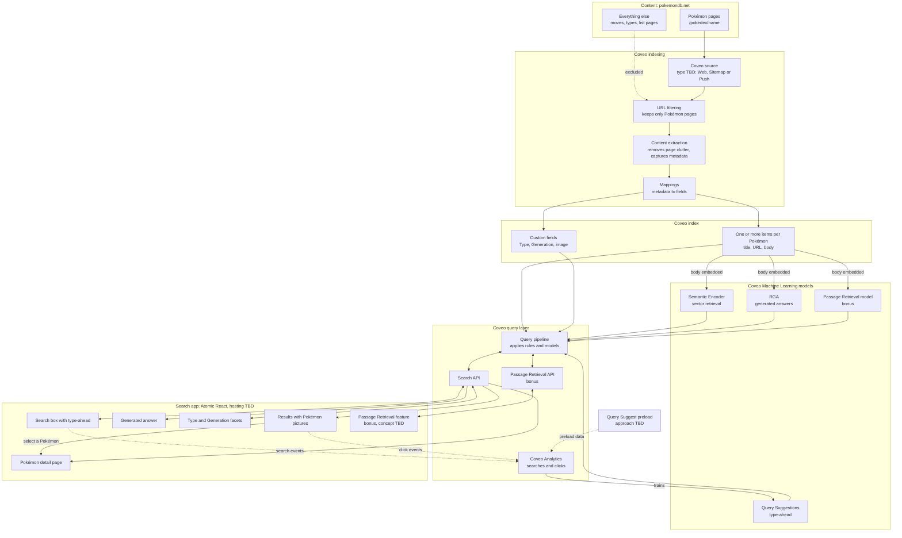

# Architecture

## Solution flow

This diagram shows the components the challenge requires and how they connect. Implementation choices are still open and are marked "TBD".

## Decisions

### Search interface: Atomic React

We will start with Coveo Atomic through its React wrapper. Atomic provides maintained components for search, facets, type-ahead and generated answers, which keeps the amount of custom interface code small.

The main cost is less control over appearance, because styling is limited to theming and the style hooks each component exposes. We considered building on Coveo Headless with our own components. That offers complete control but takes longer and adds more custom code to maintain. We can revisit this decision if Atomic proves too limiting.

### Technology stack

| Layer | Choice |
|---|---|
| Language | TypeScript |
| Application | React and Vite |
| Search interface | `@coveo/atomic-react` |
| Custom interface | shadcn/ui and Tailwind |
| Unit and component tests | Vitest and React Testing Library |
| Browser tests | Playwright |
| Evals and data scripts | TypeScript run with Node |
| CI/CD | GitHub Actions |
| Coveo configuration export | Coveo CLI |
| Hosting | To be decided |

We use one language so the project has a single toolchain. We considered Python for evals, mainly for its LLM evaluation libraries. We do not need those libraries because answers are checked against expected facts and citations. Eval speed depends on Coveo's API response times, so the language does not affect performance.

### Eval reference data

Reference data comes from pokemondb.net, the same site we index. A different source could disagree on types, forms or generations and produce false failures.

Because the reference data and the index share a source, the same extraction mistake could affect both. We reduce that risk by verifying difficult cases by hand. Raw HTML stays out of the repository, and only small derived reference data is committed.
