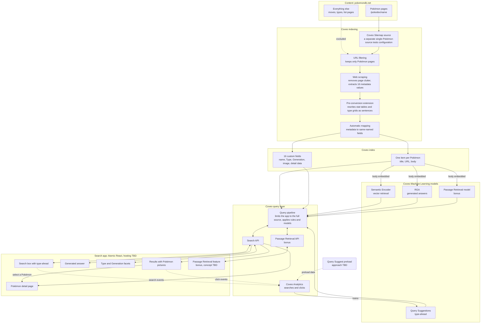

# Architecture

## Solution flow

This diagram shows the components of the solution and how they connect. Choices that are still open are marked "TBD".

## Decision summary

| Decision | Choice | Details |
|---|---|---|
| Search interface | Atomic React, revisited if too limiting | [Search interface](#search-interface-atomic-react) |
| Technology | TypeScript, with Python only for the Coveo extension | [Technology stack](#technology-stack) |
| Content scope | All 1,028 individual Pokémon pages, including incomplete new Pokémon | [Content scope](#content-scope) |
| Ingestion | Coveo Sitemap source with URL rules | [Coveo source](#coveo-source-sitemap) |
| Alternate forms | One item per Pokémon, with fields from the base form and all forms in the body | [One item per Pokémon](#one-item-per-pokémon) |
| Field extraction | XPath web scraping selectors scoped to the first form tab | [Web scraping](#web-scraping-and-fields) |
| Body text | Pre-conversion extension rewrites tables as sentences | [Body text reconstruction](#body-text-reconstruction) |
| Field mapping | Automatic mapping through `performFieldMappingUsingAllOrigins` | [Field mapping](#field-mapping) |
| Browser access | Anonymous search API key with the `pokebowl-search` search hub | [Search application connection](#search-application-connection) |
| Runtime | Node 24 | [Search application connection](#search-application-connection) |
| Application content | Dedicated `pokebowl-search` pipeline filters to the full source, and the test source is kept | [Limiting the application to the full source](#limiting-the-application-to-the-full-source) |
| Hosting | Vercel | [Hosting](#hosting) |
| Repeated platform work | Coveo APIs in place of repeated console steps | [Use of Coveo APIs](#use-of-coveo-apis) |
| Eval reference data | Sampled from pokemondb.net and verified by hand | [Eval reference data](#eval-reference-data) |

## Decisions

### Search interface: Atomic React

We will start with Coveo Atomic through its React wrapper. Atomic provides maintained components for search, facets, type-ahead and generated answers, which keeps the amount of custom interface code small.

The main cost is less control over appearance, because styling is limited to theming and the style hooks each component exposes. We considered building on Coveo Headless with custom components. That offers complete control but takes longer and adds more custom code to maintain. We can revisit this decision if Atomic proves too limiting.

**Coveo documentation:** [Atomic](https://docs.coveo.com/en/atomic/latest/), [Atomic React wrapper](https://docs.coveo.com/en/atomic/latest/usage/frameworks/atomic-react-wrapper) and [Headless](https://docs.coveo.com/en/headless/latest/). Atomic is built on Headless, and the comparison of effort between them is our judgment.

### Technology stack

| Layer | Choice |
|---|---|
| Language | TypeScript |
| Application | React and Vite |
| Search interface | `@coveo/atomic-react` |
| Custom interface | shadcn/ui and Tailwind |
| Unit and component tests | Vitest and React Testing Library |
| Browser tests | Playwright |
| Evals and data scripts | TypeScript run with Node |
| Coveo indexing extension | Python, tested with pytest |
| CI/CD | GitHub Actions |
| Coveo configuration export | Coveo CLI |
| Hosting | To be decided |

We use TypeScript for the application, tests and scripts. The one exception is the indexing extension, because Coveo runs extensions as Python. We considered Python for evals, mainly for its LLM evaluation libraries. We do not need those libraries because answers are checked against expected facts and citations. Eval speed depends on Coveo's API response times, so the language does not affect performance.

### Eval reference data

Reference data comes from pokemondb.net, the same site we index. A different source could disagree on types, forms or generations and produce false failures.

Because the reference data and the index share a source, the same extraction mistake could affect both. We reduce that risk by verifying difficult cases by hand. Raw HTML stays out of the repository, and only small derived reference data is committed.

### Content scope

The index contains every individual Pokémon page on pokemondb.net, including the newest Pokémon whose pages are still incomplete. Moves, types, list pages such as `all`, `national` and `shiny`, and all other site content are excluded. New Pokémon may have little body text and only a few entries under their Generation.

### Coveo source: Sitemap

We index with a Coveo Sitemap source because we already know exactly which pages we want and the site publishes a list of them. A Sitemap source visits only URLs listed in the sitemap and does not follow links. A Web source starts from one or more URLs and discovers pages by following links.

The sitemap covers the whole site and lists 12,923 URLs. URL rules narrow these to 1,028 individual Pokémon pages: the 1,025 numbered Pokémon and 3 new Generation 10 Pokémon that do not have numbers yet. Coveo applies the same rules to the sitemap URL, so the rules must explicitly include it.

**Benefits**

- **Less complexity:** there is no link traversal to reason about, so the result does not depend on how the site links its pages.
- **No starting-page problem:** a Web source's starting URLs must pass the source's filters. A list page used as a starting point would therefore be indexed, unless we supplied all 1,028 Pokémon URLs as starting URLs.
- **Verifiable outcome:** the expected item count is known, so a full crawl can be checked against it.

**Performance**

The performance gain is limited to crawling. Avoiding link traversal means the crawler does not need to visit pages only to discover links. Both source types are bound by the same crawl delay on the pages we index: 2 seconds between requests, as the site's `robots.txt` asks, or about 35 minutes for a full crawl. This estimate assumes Coveo requests only pages that pass the URL rules. The source type has no effect on search latency, which depends on the index and query pipeline.

**Alternatives considered**

- **Web source:** this is the better option when pages must be discovered or when one page must be split into sub-items. We need neither.
- **Push source:** this gives the most control over body text, but we would have to build and maintain a custom scraper.

**Coveo documentation**

- [Add a Sitemap source](https://docs.coveo.com/en/1967/): a Sitemap source crawls only listed pages, URL rules also apply to sitemap URLs, and the default delay between requests is 1,000 ms.
- [Add a Web source](https://docs.coveo.com/en/malf0160/): starting URLs are subject to the source's filters.
- [Sitemap source web scraping](https://docs.coveo.com/en/mahe0350/): Sitemap sources do not support sub-items.

The conclusions about complexity, the small crawl performance gain and the absence of any effect on search latency are our reasoning. The Coveo documentation does not compare the two source types on these points.

### Test source configuration

The source `pokemondb-test-charizard` indexes one page so that configuration can be tested without a full crawl. Charizard is used because its Mega forms have different Types and expose extraction mistakes.

| Setting | Value | Reason | Basis |
|---|---|---|---|
| Sitemap URLs | `https://pokemondb.net/static/sitemaps/pokemondb.xml` | This field expects the sitemap file itself. A normal web page can be read as an HTML sitemap, causing its links to be crawled. | [Add a Sitemap source](https://docs.coveo.com/en/1967/) |
| Exclusion rule | Regex excluding every URL except the sitemap and Charizard | URL rules apply to sitemap URLs as well as pages, so the sitemap must stay allowed. | [Add a Sitemap source](https://docs.coveo.com/en/1967/). Using a single exclusion regex is our approach because the console offered only exclusion rules. |
| Include all non-excluded pages | On | Provides the inclusion rule every URL must match, leaving the exclusion regex to narrow the result. | [Add a Sitemap source](https://docs.coveo.com/en/1967/) |
| Time between requests | 2,000 ms | The site's [robots.txt](https://pokemondb.net/robots.txt) asks for a 2-second delay. Coveo's default of 1,000 ms is faster than that. | Coveo default: [Add a Sitemap source](https://docs.coveo.com/en/1967/). The choice to follow robots.txt is ours. |
| Execute JavaScript on pages | Off | Coveo advises enabling this only for content rendered by JavaScript, and it can slow crawling. We confirmed that the Type and Generation markup is in the page's HTML. | [Add a Sitemap source](https://docs.coveo.com/en/1967/) and inspection of the Charizard page |
| Web scraping | [`web-scraping.json`](../configs/coveo/web-scraping.json) | Removes page navigation and sections from Moves onward, and extracts 16 metadata values from the page's first form tab. | [Web scraping configuration](https://docs.coveo.com/en/mc1f3573/) and [RGA content requirements](https://docs.coveo.com/en/nb6a0008/). Which sections to remove is our choice. |
| `performFieldMappingUsingAllOrigins` | True | Maps scraped metadata to fields with the same name. See Field mapping below. | [Add a Web source](https://docs.coveo.com/en/malf0160/), verified on our Sitemap test source |
| Content visibility | Everyone | The content is public and the application has no user sign-in. | Our decision |
| Extension | `pre-reconstruct-body` | Makes tables readable in the body. See Body text reconstruction below. | [Apply an extension](https://docs.coveo.com/en/1936/) |

### Full source configuration

The source `pokemondb-pokemon` is a duplicate of the test source and differs only in its exclusion rule, recorded in [`full-source.json`](../configs/coveo/full-source.json). Coveo's documentation recommends duplicating a source when two sources are similar, but does not list exactly what is copied, so each setting is checked after duplication.

The rule excludes every URL except the sitemap and pages directly under `/pokedex/`, then excludes the `all`, `national` and `shiny` list pages. We tested it against all 12,923 sitemap URLs. It keeps exactly the 1,025 Pokémon on the National Pokédex list and the 3 new Pokémon, and removes all moves and list pages.

### Web scraping and fields

[`web-scraping.json`](../configs/coveo/web-scraping.json) removes site navigation, the "Skip to main content" link, the Contents list and everything from the Moves section onward. It also extracts 16 metadata values, each stored in a field of the same name.

| Purpose | Fields |
|---|---|
| Search page | `pokemon_name`, `pokemon_type` (multi-value facet), `pokemon_generation` (facet), `pokemon_image` |
| Detail page | `pokemon_number`, `pokemon_species`, `pokemon_height`, `pokemon_weight`, `pokemon_abilities` (multi-value), `pokemon_hp`, `pokemon_attack`, `pokemon_defense`, `pokemon_sp_atk`, `pokemon_sp_def`, `pokemon_speed`, `pokemon_total` |

Selectors for Type, image and detail values read only the first form tab, so Mega forms cannot contaminate base-form values. All fields are strings. Stats are displayed rather than sorted, and Coveo requires non-string fields to be sortable. Stats are separate fields because a single list could lose order or repeated values. `pokemon_name` exists because the page title contains extra text that would look poor in results.

Field settings are in [`fields.json`](../configs/coveo/fields.json). Ranking and stemming are off because Coveo states that they have a significant performance cost. Free text search and caching are off because these values also appear in the body or have few distinct values. We can change this if evals show a need.

**Coveo documentation:** [Manage fields](https://docs.coveo.com/en/1833/) and [Web scraping configuration](https://docs.coveo.com/en/mc1f3573/). The rule against contaminating base-form values and the reasoning for separate stat fields are ours.

### Use of Coveo APIs

When a platform task would repeat the same manual step, we use a Coveo API instead of the console. This is faster, avoids entry errors and leaves a request body that can be reviewed in the repository.

| Task | API operation | Why | Request body |
|---|---|---|---|
| Create 12 detail-page fields | Field API, [create a batch of fields](https://docs.coveo.com/en/144/), run through Coveo's interactive API explorer while signed in | The detail page needs more data than the search page, and the same options applied to 12 fields would have been slow and error-prone to enter by hand | [`fields-batch-create.json`](../configs/coveo/fields-batch-create.json) |
| Upload Query Suggestions default queries | Machine Learning API, [Advanced Model Configurations](https://docs.coveo.com/en/qa5b0256/), `PUT configs/{configurationType}` with `DEFAULT_QUERIES` and `en`, run through Coveo's interactive API explorer while signed in | Coveo offers this configuration only through the API | [`query-suggestions-default-queries.csv`](../configs/coveo/query-suggestions-default-queries.csv) |

The first four fields (`pokemon_name`, `pokemon_type`, `pokemon_generation` and `pokemon_image`) were created in the console.

### Body text reconstruction

A Pokémon page contains valuable information in layouts that do not survive being flattened into text. A type effectiveness grid becomes a row of numbers such as `½ 2 2 ¼` with no attacking types, and a stat row becomes `78 266 360` with no labels. Generated answers read only the body text, in chunks of about 250 words, so this information would be lost or misleading.

Removing the content would have made the body cleaner but incomplete, so a pre-conversion indexing pipeline extension, [`reconstruct_body.py`](../configs/coveo/extensions/reconstruct_body.py), rewrites it before Coveo creates the body:

| Original content | Result in the body |
|---|---|
| Type effectiveness grid | Sentences such as "Charizard takes 4x damage from Rock." Each form is named, and ability-specific grids name the ability. |
| Stat table | "Charizard base stats: HP: base 78, ranging from 266 to 360 at level 100." with the total |
| Local Pokédex numbers | Kept for the base form only, because they repeat for every form |
| Stat range explanation and "Additional artwork" labels | Removed, because they add no information once the stats are labelled |

Web scraping continues to remove site navigation and everything from the Moves section onward, and to extract the 16 field values.

**Alternatives considered**

- **Remove the content with web scraping:** simplest, but generated answers could not answer questions about type effectiveness or stat ranges.
- **Post-conversion extension:** Coveo warns that editing the body after processing can make search results inconsistent, because summaries and excerpts are already extracted.
- **Body mapping:** a mapping replaces the whole body, and the documentation shows no way to retain the original page text.
- **Push source:** provides full control but discards the crawling configuration we have validated and requires a custom scraper.

**Costs and safeguards**

The extension adds Python to the project and runs for every item. Coveo limits each extension to about 5 seconds per item. The slowest of our five sample pages took 224 ms locally. It is applied with **Skip extension** on error, so a failure leaves an item indexed with its original body and does not lose it. The extension is named `pre-reconstruct-body`, requests only the **Original file** item data and is applied at the **Pre-conversion** stage to all items. It was verified in Coveo on the test source: the Charizard body contains the rewritten sentences for all three forms, and all 16 fields still populate.

**Coveo documentation:** [Modifying item bodies](https://docs.coveo.com/en/2749/) states that changing `documentdata` in a pre-conversion script is "always preferable". [Add a body mapping](https://docs.coveo.com/en/1847/) describes how a mapping overrides the body, and [Python modules available to extensions](https://docs.coveo.com/en/116/) lists BeautifulSoup. [RGA content requirements](https://docs.coveo.com/en/nb6a0008/) states that only the body is embedded. [Indexing pipeline extension overview](https://docs.coveo.com/en/1556/) describes stages and timeouts. Coveo does not document whether the stream a pre-conversion script receives is the original page or the scraped page, so the script also removes navigation and the Moves section in case they are still present.

### Field mapping

We enable the source parameter `performFieldMappingUsingAllOrigins`, so scraped metadata maps automatically to fields with the same name. Without it, the 12 fields created through the API stayed empty even though the metadata had been extracted. With it, those fields populated without any per-field mapping rules. The setting does not carry over between sources: it was missing on the first full crawl, which left the 12 fields empty on all 1,028 items and required a rebuild, so it must be set on each new source before its first build.

**Coveo documentation:** [Manage source mappings](https://docs.coveo.com/en/1640/) describes automatic mapping to matching field names, and [Add a Web source](https://docs.coveo.com/en/malf0160/) describes this parameter for Web sources. The documentation did not confirm it for Sitemap sources, so we verified it on our test source. [Manage source mappings](https://docs.coveo.com/en/1640/) advises keeping this setting off for native sources, to avoid indexing irrelevant metadata and cluttering facets. We accept that because our scraping extracts only the 16 values we want. Automatically mapped fields have no rule on the source's mapping page, which is the likely reason the console lists these fields as unused in sources, although Coveo does not document that count.

### One item per Pokémon

Each Pokémon page becomes one item. Alternate forms such as Mega Evolutions appear as tabs on the same page, sometimes with a different Type. Type, image and other structured values are read only from the first tab, which is the base form. Charizard is therefore Fire and Flying, even though Mega Charizard X is Fire and Dragon. Alternate-form details remain in the body text, so they can still be searched and used in generated answers.

The cost is that users cannot filter by alternate form. We considered separate items for each form, but they create near-duplicate content that weakens generated answers.

**Coveo documentation:** [RGA content requirements](https://docs.coveo.com/en/nb6a0008/) recommends avoiding near-duplicate documents and notes that only the body field is embedded. Applying that guidance to alternate forms is our inference.

### Generation extraction

Each page states the Generation in a dedicated tag within its introduction, for example "introduced in Generation 1". We read it with a web scraping selector, because a selector is enough to capture a value that is already isolated in the page.

**Coveo documentation:** [Web scraping configuration](https://docs.coveo.com/en/mc1f3573/) describes CSS and XPath 1.0 selectors for extracting metadata, and states that extracted metadata needs fields and mappings before it can be used. The selector was verified on the test source.

## Search application connection

The application is a React and TypeScript page built with the official Atomic React wrapper, `@coveo/atomic-react`. It connects directly from the browser to Coveo with a search-only API key.

**Decision: use the Atomic React wrapper.** It lets result templates be written as ordinary JSX. The rejected alternative was using Atomic's web components directly, which adds no capability here and requires manual template and component setup.

**Decision: use one Anonymous search API key, `pokebowl-search-browser`, with the search hub `pokebowl-search`.** The rejected alternative was server-generated search tokens, which add a backend that public content does not need. Evals will use a separate key and search hub so their traffic stays out of the analytics used for model training.

**Decision: run on Node 24.** The current Atomic packages declare support for Node up to the 24 line. On Node 26, npm silently installs a much older Atomic release, so `.nvmrc` and the `engines` field pin the project to Node 24.

**Coveo documentation:** [Use API key authentication with the Search API](https://docs.coveo.com/en/105/) states that browser code may use only an Anonymous search key for public content, or a search token generated on a server. [Manage API keys](https://docs.coveo.com/en/1718/) lists the privileges of that template: Execute queries, Execute agent queries, and Analytics data push. [Atomic usage](https://docs.coveo.com/en/atomic/latest/usage/) states that the access token should enforce a search hub. [Use the React wrapper](https://docs.coveo.com/en/atomic/latest/usage/frameworks/atomic-react-wrapper/) states that the search hub must be set in the engine configuration, and that icons and labels must be served from the public directory.

**Facets:** Type uses alphabetical order. Generation uses natural order, `alphanumericNatural`, so Generation 10 follows Generation 9, which plain text sorting does not do.

**Search hub enforcement:** the browser key enforces `pokebowl-search` in Coveo. In a live test, requests sent with another search hub, or with none, were still routed to the `pokebowl-search` pipeline. [Ensure that authentication enforces search hub values](https://docs.coveo.com/en/las95231/) recommends enforcing the hub in the key or token. It does not state whether a client can override it, so this behavior is our observation. Evals and any query of the test source need a separate key.

**Our inference:** we do not treat the search hub as a security control, and all of this content is public. The wrapper documentation shows asset setup only for Create React App, so we copy the same folders into Vite's `public/` directory and confirmed the result in a browser.

## Limiting the application to the full source

The single-Pokémon test source stays in the organization for testing configuration changes, so the index holds 1,029 items and Charizard exists twice. A dedicated query pipeline, `pokebowl-search`, receives queries from any search hub containing `pokebowl-`, and a filter rule on that pipeline limits them to `pokemondb-pokemon`. The default pipeline has no condition and no filter rule.

**Decision: use a dedicated pipeline with a filter that includes the full source.** The rejected alternatives were:

- Deleting the test source, which removes our safe place to test configuration.
- Filtering in the application, which would not apply to requests made outside it.
- A filter rule on the default pipeline, which we applied first and then replaced. Its search hub condition would not have covered the separate eval search hub, and rules and models on the default pipeline apply broadly.

**Decision: do not create a Coveo project for now.** Projects group related resources and do not change search behavior, so one is not needed for the application to work. One can be added later without changing the configuration.

**Coveo documentation:** [Set up a query pipeline](https://docs.coveo.com/en/2757/) states that routing everything to the default pipeline works only for a single website or application. [Manage query pipelines](https://docs.coveo.com/en/1791/) describes dedicated pipelines with conditions and states that the default pipeline should have no condition. [Query pipeline routing](https://docs.coveo.com/en/1666) recommends condition-based routing on the search hub with positive operators. [Manage filter rules](https://docs.coveo.com/en/3410/) recommends filters that include content rather than exclude it, and states that filters alone do not prevent content from being exposed. [Filter: Query pipeline feature](https://docs.coveo.com/en/1440/) states that the constant part of the query is combined with AND and is unsuited to dynamic content. [Manage projects](https://docs.coveo.com/en/n7ef0517/) describes projects.

**Our inference:** the filter is a relevance control and not a security control, which is acceptable because all of this content is public. A query using the browser key with a different search hub returned no test source items, which suggests the key's search hub takes precedence, but we did not confirm this.

## Visual direction

The interface is polished yet playful: a calm, spacious structure with a friendly, tactile personality, because the application is themed around Pokémon but is shown to an enterprise audience.

- A warm off-white base keeps attention on the artwork.
- Each card's artwork sits on a tint of the Pokémon's Type, and dual-Type Pokémon blend both colors.
- Rounded type (Nunito, self-hosted), pill badges, and cards with a heavier bottom edge give a tactile feel.
- Type badge text is chosen for contrast, and a unit test holds every badge to at least 4.5:1.
- The layout, colors and components are original and do not copy official Pokémon styling.

Page sizes and result columns are defined once in `src/search/settings.ts`, and page sizes are multiples of both column counts so that every row is full. The default of 12 and the 3 and 4 column layouts are desktop choices; phone layouts were dropped from scope at the user's request.

Our markup uses Tailwind and shadcn/ui. Atomic's components are styled through [theme variables and CSS parts](https://docs.coveo.com/en/atomic/latest/usage/themes-and-visual-customization/), because they use Shadow DOM and Tailwind classes cannot reach inside them. Result cards are rendered inside Atomic's Shadow DOM, so one shared stylesheet is adopted there instead of copying styles into each result. Some rules that override Atomic's page layout use `!important`, which Coveo does not document as an approach; they remain because the layout has no documented setting for a single centered content block.

Atomic's clear button only empties the text, so the application runs a search for everything, from the first page, when that button is used. Emptying the box by keyboard follows Atomic's behavior and waits for Enter, which avoids unrequested searches and false submit events in analytics. The search uses the `searchboxSubmit` event because Headless has no public event for clearing, and it fires only on the explicit button. Facets request up to a fixed ceiling so that a new Generation or Type is never hidden.

**Decision: center the page numbers on the page.** The pager has a full-width row below the facets and results, on the same axis as the title and search box. The `pagination` layout section is a direct child of `atomic-search-layout` with its own grid area, so its position does not depend on the facets width. The rejected alternative was centering it under the results column, which put it off the page axis.

**Decision: use Atomic's `atomic-results-per-page` for page sizes.** It hides itself on errors and empty results, so we do not maintain that logic. It replaced a custom dropdown built on Headless and shadcn/ui. It shows buttons instead of a dropdown, and it is styled through CSS parts to match the pager.

**Decision: remove unsupported sort and page size values from the URL before the application starts.** Atomic restores URL state as written. A sort that Coveo rejects makes Atomic remove the sort control, which leaves no way to change it, and a page size that is not offered leaves rows partly empty. `src/search/urlState.ts` keeps only the offered values and leaves other entries unchanged.

**Rejected alternatives:** a restrained product look, which undersells the theme, and a dark editorial look, which suits the artwork less well on tinted cards.

## Search behavior

The Type and Generation facets start collapsed at the user's request, set with one value on Atomic's facet manager (`collapseFacetsAfter`, 0 collapses all facets).

Three behaviors are added on top of Coveo's default relevance search.

**Decision: a number-only search is a Pokédex lookup.** A query that is only a number, such as `3` or `#25`, returns the one Pokémon with that Pokédex number, and a notice above the results says so. Without this, a number matches every occurrence of that number in the body text, including stats and Generation labels, so `3` returned 806 Pokémon. The rejected alternative was boosting the exact match and keeping the other results, which leaves the same noise below it. Text searches such as `Generation 3` are unchanged.

**Decision: the home page is in Pokédex order.** An empty query has nothing to rank on, so Coveo's order looks arbitrary. When no search text exists and no other sort was chosen, the application sorts by Pokédex number. New Pokémon whose number is `???` sort last. The rejected alternative was a curated list, which needs maintenance and does not help browsing.

**Decision: Best match follows the common industry pattern.** Relevance is the usual default sort, under names such as Best Match or Featured ([Elastic](https://docs-v3-preview.elastic.dev/elastic/docs-builder/docs/3915/reference/search-ui/solutions-ecommerce-search-page.md), [Algolia](https://www.algolia.com/blog/ux/best-practices-for-site-search-ui-design-patterns)). With no search text there is nothing to rank, so the default order is Pokédex order. Baymard warns that a label should not suggest a different order from the one applied ([Baymard](https://baymard.com/blog/default-sort-type)). That is the tradeoff here, because Best match and Pokédex number give the same order on the home page. No single authoritative standard exists for this case.

**Decision: add query correction and a sort control.** Coveo lists these among standard search interface components. The sort options are best match, Pokédex number and name. `pokemon_number` and `pokemon_name` have the **Sort** option enabled in Coveo. We did not enable **Use cache for sort**, because a sorted query already takes about 22 milliseconds in the search API.

**Coveo documentation:** [Modify requests and responses](https://docs.coveo.com/en/atomic/latest/usage/atomic-modify-requests-responses/) describes the request hook, and advises limiting it to search requests and coding defensively. It recommends the Headless advanced query action for setting `aq`, without giving a reason. [Ensure that your search interfaces contain standard components](https://docs.coveo.com/en/mc2g0332/) covers query correction and sorting. [Manage fields](https://docs.coveo.com/en/1833/) states that the Sort option needs no rebuild, though a delay may occur.

**Our inference:** we use the request hook despite that recommendation, because the lookup must also clear the text query in the same request, and the advanced query action cannot do that. The search box and analytics keep the text the person typed.

## Hosting

**Decision: host the application on Vercel.** It connects to the GitHub repository, deploys when changes merge, and needs little setup for a static Vite application. The rejected alternative was Netlify, which offers similar deployment features. The application is a static page that calls Coveo from the browser, so it needs no server. The Coveo organization ID and the search-only key are set as build variables in Vercel, and they reach the browser by design.

## Query Suggestions

Query Suggestions is the type-ahead list in the search box. Its model learns from analytics of what people searched and clicked, and it does not read the index. This application has no real users, so the model has no history to learn from.

**Decision: pre-populate the model with a default queries file, uploaded through the Advanced Model Configurations API.** This is the method Coveo documents for test and low-traffic environments. Enrichment comes after this baseline works, and only if it adds value.

**First file:** `configs/coveo/query-suggestions-default-queries.csv`, with 2,234 queries generated from values in the index: 1,028 Pokémon names, 18 Types, 10 Generations, 178 Type pairs, 284 abilities and 716 species. Each query other than a name was tested against the index with analytics capture off, and 10 were dropped because no top-12 result carried the value. The first file carried no importance values, because any popularity numbers would be invented. Longer natural-language questions were left out, because the purpose of this feature is completing what a person types. A few could be added after generated answers work.

**Rejected as the first step: scripted sessions that search and click through the application.** The events would be correctly formed, but the traffic would be synthetic, and scripted volume would still be far below what the model needs to learn well. It remains the fallback if the model cannot become active without more analytics. If used, it would be disclosed as synthetic and kept to the `pokebowl-search` hub.

**Rejected: scripted calls directly to the Search and Analytics APIs.** Our code would have to reproduce the event format that Atomic already produces.

**Possible enrichment, after the baseline:** importance values based on real query counts once they exist, more descriptive searches informed by general search practice, and removal of poor suggestions with a blocklist.

**Coveo documentation:** [Troubleshoot Query Suggestions models](https://docs.coveo.com/en/q6qc0388/) states that a model needs approximately 10,000 search events to produce learned suggestions, and that a test or low-traffic environment can be pre-populated with a default queries file. [Set advanced QS model configurations](https://docs.coveo.com/en/qa5b0256/) describes the file: a UTF-8 CSV without headers, at most 5,000 queries per language, with an optional importance value. [Create and manage a QS model](https://docs.coveo.com/en/3398/) states that a model needs at least 100 events to provide recommendations, and that Test configuration mode is available only in sandbox organizations. [Reviewing query suggestion candidates](https://docs.coveo.com/en/2010/) states that, at low volume, a query qualifies after one search followed by a click.

**Our inference:** Coveo does not state whether a model becomes active with almost no analytics, or whether uploading the file triggers a rebuild. We will confirm both when the model is created. Choosing names and descriptive searches for the file is a product decision.

**Learning interval:** a 1-month data period with daily builds, which Coveo's table lists as a valid pairing. We changed it from the default so that a rebuild picks up the uploaded file soon after upload. Immediately after the upload, the Query Suggestion API returned only a learned query. After the rebuild it returned the file's queries, which supports our inference that the file takes effect on a rebuild. Coveo does not document this.

**Ranking:** the user chose to add the file's optional importance column by category, so that Pokémon names come before abilities and species. The first upload had equal importance, and `char` listed `charm` first and Charizard seventh. These values rank categories and do not claim to be popularity. Upload of the ranked file is pending.

### In production

A client deployment would go further than this baseline:

1. **Log real queries and clicks.** The application already logs them through Atomic. Each model rebuild then learns from real behavior, and the default queries file becomes a starting point that real data overtakes. Coveo recommends a [data period that covers at least 10,000 queries](https://docs.coveo.com/en/3398/), with 3 months and weekly rebuilds as its recommended setting.
2. **A/B test before full rollout.** Coveo's [leading practice](https://docs.coveo.com/en/l1mf0321/) is to test a new model on a share of the traffic and compare search performance with and without it.
3. **Monitor suggestion quality.** Report on [searches that came from a suggestion](https://docs.coveo.com/en/2010/), which have the `omniboxAnalytics` event cause, and use the click-through measures in the [model card](https://docs.coveo.com/en/p2ac0141/).
4. **Maintain the suggestions.** Use a [blocklist](https://docs.coveo.com/en/qa5b0256/) for unwanted terms. The [model card](https://docs.coveo.com/en/p2ac0141/) notes that the model can keep suggesting queries for removed content until it retrains.
5. **Keep test traffic out.** Evals and monitoring use a separate search hub so they do not train the model.

## Pokémon detail page

**Decision: each result opens a detail page in this application, at a URL such as `/?pokemon=Mr.%20Mime`.** The page shows artwork, name, number, Types, Generation, species, height, weight, abilities and base stats, and links to the source page on pokemondb.net. The user confirmed this content.

A query parameter needs no rewrite rules on Vercel and does not interfere with the `#` state that Atomic keeps in the URL. The rejected alternative was a path URL such as `/pokemon/mr-mime`, which needs hosting rewrites.

The page reads one item through a separate Headless engine with analytics off, using an exact match on the name. Coveo's `==` operator treated `?` and `*` as wildcards in our testing, so the page also checks that the returned name equals the requested name. Pokémon with `???` as their number hide it and state that base stats are not available. Result cards use Atomic's link templates, so a card click still logs Atomic's click event.

The work is on `feature/detail-page`, which must merge after `fix/code-review-findings`. Not confirmed: real artwork on the page, and that the click event reaches Coveo in production.
